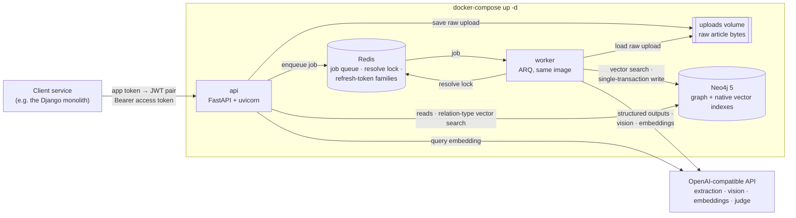
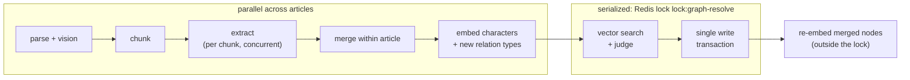
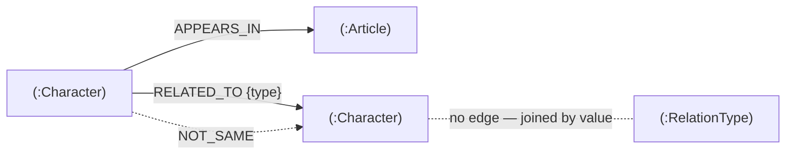

# Character Graph Service

> **Кратко.** Прототип микросервиса на FastAPI. Он принимает статьи в Markdown или PDF; изображения внутри PDF описывает vision-модель. LLM извлекает из статей персонажей и связи между ними (Structured Outputs + Pydantic), а результат сохраняется в Neo4j. Neo4j здесь одновременно графовая и векторная БД: в нём есть встроенный векторный индекс.
> Персонажи из разных статей объединяются через векторный поиск и LLM-судью. Тяжёлая обработка идёт в фоновом воркере (ARQ + Redis).
> Запуск: `cp .env.example .env`, указать `OPENAI_API_KEY`, затем `docker-compose up -d`.
> Ниже описаны архитектура, схема графа и тексты промптов, а также как получить токены. Для каждого эндпоинта есть пример curl.

The service ingests articles (Markdown text or PDF files, including the images inside PDFs) and uses an LLM to extract the **characters** they mention: people and other animate beings, real or fictional. It also extracts the **relations** between those characters. Everything is stored as a graph in Neo4j, and the API answers questions such as "who is a friend of character X".

The same character found in different articles, even under names in different languages such as "Anna Petrova" and "Анна Петрова", is resolved to a single node. The service does this with Neo4j's native vector index and an LLM judge.

It was built as a take-home prototype of an AI microservice that a Django monolith would call. The original assignment (in Russian) is the source of truth for the functional requirements. [Assignment ambiguities and chosen interpretations](#assignment-ambiguities-and-chosen-interpretations) lists every place where its wording had to be interpreted.

## Contents

- [Quick start](#quick-start)
- [The core path: from upload to graph](#the-core-path-from-upload-to-graph)
- [Endpoints](#endpoints)
- **Required by the assignment**
  - [Architecture](#architecture)
  - [Graph schema](#graph-schema)
  - [AI pipeline](#ai-pipeline)
  - [Prompts](#prompts)
  - [Getting tokens](#getting-tokens)
  - [curl examples for every endpoint](#curl-examples-for-every-endpoint)
- **Depth and reference**
  - [Robustness & advanced design](#robustness--advanced-design)
  - [Assignment ambiguities and chosen interpretations](#assignment-ambiguities-and-chosen-interpretations)
  - [Configuration](#configuration)
  - [Choosing an LLM provider and models](#choosing-an-llm-provider-and-models)
  - [Tests](#tests)
  - [Limitations & next steps](#limitations--next-steps)

## Quick start

Requirements: Docker with Compose, and an OpenAI API key (or a key for another OpenAI-compatible provider, see [Choosing an LLM provider and models](#choosing-an-llm-provider-and-models)). The stack is verified with the legacy `docker-compose` 1.29, the command the assignment names; `docker compose` v2 reads the same file.

```bash
cp .env.example .env
# edit .env: set OPENAI_API_KEY=sk-...
docker-compose up -d
```

The first `up` builds the image. Neo4j then needs a minute or two to become healthy; `api` and `worker` start only after Neo4j and Redis report healthy. To check the stack:

```bash
curl -s localhost:8000/health/ready
# {"status":"ok","neo4j":"ok","redis":"ok"}
```

Then [get a token](#getting-tokens) with the demo app token `demo-app-token` and follow the [curl examples](#curl-examples-for-every-endpoint).

- **Web UIs.** Swagger UI is at <http://localhost:8000/docs>; its "Authorize" button takes the access token. The Neo4j Browser is at <http://localhost:7474> (user `neo4j`, password `password` or your `NEO4J_PASSWORD`).
- **Make targets.** `make up` (`docker-compose up -d --build`), `make logs`, `make token`, `make down`.
- **Without an OpenAI key.** The stack also starts without `OPENAI_API_KEY`. Auth and all reads work. Uploads end with `status: failed` and the error `LLMNotConfiguredError: OPENAI_API_KEY is not set`. Endpoints that need embeddings answer `503 llm_unavailable`.
- **Before leaving a local demo.** The compose file ships demo values for `JWT_SECRET` and `APP_TOKENS`. Change both: see [Getting tokens](#getting-tokens) and [Configuration](#configuration).

## The core path: from upload to graph

**upload → parse (incl. vision) → chunk → extract (Structured Outputs) → merge → resolve (vector dedup + judge) → persist**

| # | Step | What happens | Code |
|---|---|---|---|
| 1 | **Upload** | JSON text, a multipart file (PDF by magic bytes, or Markdown) or a form `text` field is hashed for idempotency, stored on a shared volume and queued, answering `202` (or the finished article with `?wait=true`). | [`app/api/routes/articles.py`](app/api/routes/articles.py), [`app/api/uploads.py`](app/api/uploads.py), [`app/storage.py`](app/storage.py), [`app/queue.py`](app/queue.py) |
| 2 | **Worker** | The ARQ worker (same image as the API) runs `process_article`, which orchestrates the steps below. | [`app/worker.py`](app/worker.py), [`app/pipeline/process.py`](app/pipeline/process.py) |
| 3 | **Parse** | Markdown is used as is, while a PDF contributes each page's text plus **vision-model** descriptions of its images, scans and diagram pages, inlined as `[Image on page N: …]`. | [`app/ingestion/markdown.py`](app/ingestion/markdown.py), [`app/ingestion/pdf.py`](app/ingestion/pdf.py) |
| 4 | **Chunk** | Paragraphs are packed into chunks of up to 6000 characters with 500 characters of overlap. | [`app/ingestion/chunking.py`](app/ingestion/chunking.py) |
| 5 | **Extract** | Chunks go to the LLM concurrently with **Structured Outputs** (`chat.completions.parse` with a strict schema generated from Pydantic models), and the prompt lists the known relation types for reuse. | [`app/llm/client.py`](app/llm/client.py), [`app/llm/schemas.py`](app/llm/schemas.py), [`app/llm/prompts.py`](app/llm/prompts.py) |
| 6 | **Merge** | Chunk results are merged by normalized name and alias, relation types are normalized to `UPPER_SNAKE_CASE`, and relations with unresolvable endpoints are dropped. | [`app/pipeline/merge.py`](app/pipeline/merge.py) |
| 7 | **Resolve** | Under a Redis lock, a **vector search** finds the nearest existing characters: near-identical ones merge, borderline ones go to the **LLM judge** with graph context, and the rest become new ([thresholds](#ai-pipeline)). | [`app/pipeline/resolve.py`](app/pipeline/resolve.py), [`app/pipeline/matching.py`](app/pipeline/matching.py), [`app/pipeline/lock.py`](app/pipeline/lock.py) |
| 8 | **Persist** | One Neo4j write transaction `MERGE`s characters, edges, new relation types and judge verdicts and marks the article `done`, and merged nodes are re-embedded afterwards. | [`app/graph/persist.py`](app/graph/persist.py) |

The read endpoints query Neo4j directly ([`app/api/routes/characters.py`](app/api/routes/characters.py), [`app/api/routes/relations.py`](app/api/routes/relations.py)). `GET /relations/connected` first tries an exact match on the normalized type. If that fails, it resolves the free-form `type` (`friend`, `друг`) through the `RelationType` vector index.

## Endpoints

All endpoints except `/auth/*` and `/health/*` require `Authorization: Bearer <access token>`. Errors always have the shape `{"error": {"code": "<snake_case>", "message": "<text>"}}`.

| Method & path | Purpose | Success |
|---|---|---|
| `POST /auth/token` | Exchange an app token for an access + refresh pair | `200` token pair |
| `POST /auth/refresh` | Rotate a refresh token (single use, reuse detection) | `200` token pair |
| `POST /articles/upload[?wait=true&wait_timeout=60]` | Upload Markdown text or a PDF/Markdown file | `202` accepted, `200` existing or finished |
| `GET /articles/{article_id}` | Processing status, error and stats | `200` article |
| `GET /characters?limit=50&offset=0` | All characters, ordered by name, paginated | `200` page |
| `GET /characters/by_article/{article_id}` | Characters that appear in an article | `200` list |
| `GET /relations/types` | Relation types in use, with usage counts | `200` list |
| `GET /relations/connected/{character_id}?type=…` | Characters connected by a relation type, in both directions, with evidence | `200` |
| `POST /characters/merge` | Manually merge duplicate characters into a target | `200` merged character |
| `POST /characters/reconcile` | Queue a duplicate-reconciliation run | `202` `{"status":"queued"}` or `{"status":"already_queued"}` |
| `GET /health/live`, `GET /health/ready` | Liveness; readiness (Neo4j + Redis) | `200` / `503` |

The first eight rows are the assignment's endpoints plus what an asynchronous upload needs (`/auth/refresh`, `/articles/{id}`). Merge and reconcile are additions for fixing duplicates: see [Robustness & advanced design](#robustness--advanced-design).

---

## Architecture



**Services** (`docker-compose.yml`):

| Service | Role |
|---|---|
| `api` | The FastAPI app. On startup it applies the schema. It answers reads, accepts uploads and queues jobs. |
| `worker` | Runs the article pipeline, the stuck-article sweep and the optional reconciliation cron. |
| `neo4j` | The graph DB and vector DB in one service: `neo4j:5.26-community`, using its native vector indexes. |
| `redis` | Holds the ARQ queue, the resolve lock and the refresh-token state. It is not published on the host. |

The API is published on all interfaces (`API_PORT`). The Neo4j ports (`NEO4J_HTTP_PORT`, `NEO4J_BOLT_PORT`) are bound to `127.0.0.1` only, so the database is reachable from the host for debugging but not from the network.

All four have health checks, and `api`/`worker` start only when Neo4j and Redis are healthy. Raw uploads are passed from api to worker through the shared `uploads` volume, so Redis never carries 20 MiB blobs. The worker deletes the blob once the article's final status is stored (see [Retries on infrastructure errors](#retries-on-infrastructure-errors)).

### Neo4j as both the graph DB and the vector DB

The assignment allows this explicitly:

> Обязательно использовать **Векторную БД** (или встроенный векторный индекс в графовой БД, если она это поддерживает) для ускорения поиска/дедупликации сущностей или семантического поиска связей.

Neo4j 5 has native HNSW vector indexes. We use them for both purposes the clause names: deduplicating characters (`character_embedding`) and semantic search over relation types (`relation_type_embedding`). Keeping the vectors next to the graph means the dedup lookup and the write happen against one consistent store. There is no second database to keep in sync, and no dual write that could half-fail. The `docker-compose.yml` deliverable ("API, Graph DB, Vector DB") is satisfied by the `neo4j` service playing both roles.

### Processing phases

Parsing, vision and extraction are the expensive, slow part of the pipeline, and they run in parallel across articles. Resolve and persist are short, and they are serialized by a Redis lock. The vector search therefore always sees characters that a concurrently processed article has just committed. Without the lock, two articles that introduce the same new person at the same time would each create a node.



### Code layout

Dependencies point inward. `domain` (models, name normalization, character profiles) imports nothing from the outer layers. `pipeline` and `graph` never import `api` or FastAPI, so the worker runs the same code without the HTTP stack; HTTP errors are plain exception classes in `app/errors.py`, and only `app/api/errors.py` maps them to responses. The pipeline talks to the LLM only through the `LLMClient` protocol, so tests inject a fake. [`tests/unit/test_layering.py`](tests/unit/test_layering.py) enforces these rules by walking the imports.

```
app/
  main.py, container.py     app factory, lifespan, dependency container (driver, redis, queue, LLM)
  config.py                 Settings (pydantic-settings), every env var below
  errors.py                 application errors with status code and error code, no HTTP imports
  api/                      routes, error handlers, upload parsing with streaming limits, auth dependency, schemas
  auth/                     JWT issue/verify/rotate with reuse detection, app-token CLI
  domain/                   models, name and relation-type normalization, character profile building/hashing/merging
  ingestion/                markdown, pdf (text + images + page rendering), chunking, content fingerprint
  llm/                      OpenAI client (structured outputs), prompts (single source), output schemas
  pipeline/                 process, merge, resolve/matching, lock, manual merge, reconcile, sweep, relation-type lookup
  graph/                    schema (constraints, vector indexes); articles, characters (reads, vector search),
                            persist (article write transaction, NOT_SAME), merge; GraphRepository composes them
  worker.py, queue.py       ARQ worker settings, cron jobs, queue abstraction (arq | inline)
```

## Graph schema



`RelationType` has no edges: it is the vocabulary that `RELATED_TO.type` references by name.

### Nodes

| Label | Properties |
|---|---|
| `Article` | `id` (UUID4), `title`, `format` (`markdown`\|`pdf`), `content_hash`, `status` (`pending`\|`processing`\|`done`\|`failed`), `error`, `stats_characters`, `stats_relations`, `stats_images_described`, `stats_unjudged_characters`, `created_at`, `updated_at` |
| `Character` | `id` (UUID4), `name`, `aliases` (list), `description`, `embedding` (float list), `embedding_stale` (bool), `needs_reconcile` (bool), `created_at`, `updated_at` |
| `RelationType` | `name` (English `UPPER_SNAKE_CASE`, e.g. `FRIEND_OF`), `description`, `embedding` |

The `title` comes from the explicit `title` field, else the first Markdown heading or the PDF metadata, else the file name. A character's `name` is stored as written in the source, with no transliteration. Its `embedding` is computed from `"<name>; aliases: <aliases>; <description>"`.

### Relationships

| Type | Properties | Meaning |
|---|---|---|
| `(:Character)-[:APPEARS_IN]->(:Article)` | `match` (`new`\|`vector`\|`judge`), `similarity`, `mentions_json` | The character appears in the article. `mentions_json` is the provenance of every mention that resolved to this node: the surface name, the description in that article, the match kind and the cosine. It serves for auditing merges and as groundwork for a split operation. |
| `(:Character)-[:RELATED_TO]->(:Character)` | `type`, `article_id`, `description`, `evidence`, `created_at` | A directed relation read as "source `type` target". The key is (source, target, `type`, `article_id`), so the same relation stated in two articles keeps both pieces of evidence, and re-processing is idempotent. |
| `(:Character)-[:NOT_SAME]->(:Character)` | `reason`, `judged_at`, `hash_low`, `hash_high` | A negative judge verdict. See [NOT_SAME verdicts](#not_same-verdicts). |

**Why a generic `RELATED_TO {type}` and not dynamic relationship types (`-[:FRIEND_OF]->`)?** Relation types come from the LLM: an open, untrusted vocabulary. Cypher cannot parameterize relationship types, so dynamic types would require building Cypher strings from model output. A property can be passed as a parameter, indexed (`related_to_type`) and filtered on like any other value. `GET /relations/types` becomes a simple aggregation, and a query for "any relation" is still just `-[:RELATED_TO]-`. The cost is that traversals filter on a property instead of a type, which the index makes cheap at this scale.

Every query that reads relations names `RELATED_TO` explicitly, so `NOT_SAME` edges never leak into API responses.

### Constraints and indexes

Applied idempotently (`IF NOT EXISTS`) when the api and the worker start ([`app/graph/schema.py`](app/graph/schema.py)), followed by `db.awaitIndexes()`:

| Name | Definition |
|---|---|
| `article_id` | unique `Article.id` |
| `article_content_hash` | unique `Article.content_hash`, which closes the race between two identical concurrent uploads |
| `character_id` | unique `Character.id` |
| `relation_type_name` | unique `RelationType.name` |
| `related_to_type` | range index on `RELATED_TO.type` |
| `character_embedding` | vector index on `Character.embedding`, cosine, `EMBEDDING_DIM` dimensions (1536) |
| `relation_type_embedding` | vector index on `RelationType.embedding`, cosine, `EMBEDDING_DIM` dimensions |

If an existing vector index has a different dimension than `EMBEDDING_DIM`, startup fails fast with a `SchemaMismatchError` that names the index.

The driver disables only the `UNRECOGNIZED` notification classification ([`app/container.py`](app/container.py)). This silences the "label/property does not exist" noise that queries log on a fresh database; all other notifications are kept.

To explore the graph in the Neo4j Browser:

```cypher
MATCH (s:Character)-[r:RELATED_TO]->(t:Character)
RETURN s.name, r.type, t.name, r.evidence LIMIT 50;

MATCH (c:Character)-[m:APPEARS_IN]->(a:Article)
RETURN c.name, m.match, m.similarity, a.title;
```

## AI pipeline

**Structured Outputs and Pydantic.** All three chat calls (extraction, vision, judge) go through `client.chat.completions.parse(response_format=<Pydantic model>, temperature=0)` ([`app/llm/client.py`](app/llm/client.py)). The OpenAI SDK turns the model into a strict JSON schema, and the API constrains decoding to that schema. Every model uses `extra="forbid"` ([`app/llm/schemas.py`](app/llm/schemas.py)), which strict mode requires, and the reply is validated by Pydantic again on the way in:

| Call | Response model |
|---|---|
| extraction | `ExtractionResult { characters: [{name, aliases, description}], relations: [{source, target, type, description, evidence}] }` |
| vision | `ImageDescription { description }` |
| judge | `DedupVerdict { same: bool, reason }` |

On failure:

- An invalid structured output, a refusal or an empty parse is retried once.
- Transport errors and 429/5xx responses are retried by the SDK with backoff (`LLM_MAX_RETRIES`).
- Embedding vectors are put back in input order by their `index`. Some OpenAI-compatible providers return `index: null`; then the response order is used, which is the input order. A response with a different number of vectors than inputs fails as an LLM error.
- A failure that remains fails the article with the error recorded. There are two exceptions. A failed image description is logged and skipped, so one bad image does not lose the article. A failed judge call degrades to "not merged" (see the judge-outage note in [AI pipeline](#ai-pipeline) below).

**Within-article merge** ([`app/pipeline/merge.py`](app/pipeline/merge.py)). Chunk results are grouped by normalized name (NFKC, casefold, edge punctuation stripped). Groups are linked when one's name is another's alias. Linked groups that co-occur in the same chunk stay separate: the model listed them as two people there. Of the merged names, the longest one wins, and so does the longest description.

Relation endpoints resolve by name, or by an alias that belongs to exactly one character. Unresolvable endpoints and self-relations are dropped. Relation types are normalized to `UPPER_SNAKE_CASE` (`friend of` → `FRIEND_OF`). At write time, a type is reused only on an exact normalized-name match. There is no semantic merging of types, because antonyms such as `PARENT_OF` and `CHILD_OF` have close embeddings.

**Resolve against the graph (dedup)** ([`app/pipeline/matching.py`](app/pipeline/matching.py)). Each merged character is embedded, and the vector index returns the `DEDUP_CANDIDATES` nearest characters (5).

| Raw cosine | Decision | `APPEARS_IN.match` |
|---|---|---|
| ≥ `DEDUP_AUTO_MERGE_THRESHOLD` (0.95) | same character, merged without asking | `vector` |
| ≥ `DEDUP_JUDGE_THRESHOLD` (0.65) | the **LLM judge** decides; candidates are tried in similarity order until one is judged the same | `judge` |
| lower, or every judge says no | new character | `new` |

- **Biased against wrong merges.** A wrong merge corrupts the graph silently, while a missed merge can be fixed later with the [manual merge](#fix-duplicates) or [reconciliation](#reconciliation-opt-in). The auto-merge threshold is therefore very high, and the judge band below it is wide: the same person written in two languages can score as low as 0.80 ([measured](#measured-on-real-embeddings)), so such pairs must reach the judge instead of becoming new nodes. The judge sees graph context for both sides: up to 20 relations with other characters and up to 5 article titles. Its prompt says outright that a shared name is never enough on its own.
- **Judge budget.** Judge calls are capped per article (`DEDUP_MAX_JUDGE_CALLS_PER_ARTICLE`, 10). When the cap is reached, the remaining borderline candidates become new characters, flagged `needs_reconcile = true`.
- **Judge outage.** The judge is an auxiliary check, so its failure never fails the article. When a judge call still fails after the SDK retries (a 429, a timeout, an invalid output), that pair counts as not judged: no merge and no `NOT_SAME`. The judge is then skipped for the rest of the article, so later characters do not wait through more retries. Auto-merge still applies; every other borderline character becomes a new node flagged `needs_reconcile = true`. Verdicts returned before the failure are kept. The article ends `done`, `stats.unjudged_characters` counts the characters left unjudged, and one `judge_unavailable` warning per article logs the error type, the error message (truncated to 200 characters) and that count. Only `LLMNotConfiguredError` (no API key) still fails the article.
- **Merging into an existing node.** The node keeps its name. The aliases are unioned, with the incoming name added as an alias, and the longer description wins.
- **Same-chunk characters never share a node.** Each merged character remembers the chunks it came from. Two characters that appear in the same chunk were listed by the model as two people, so once one of them has matched an existing node, that node is excluded from the other's candidates, and the other goes on to the next candidate or becomes a new node. This is the same rule as in the within-article merge. Characters from different chunks may still fold into one existing node, for example `Anya` in chapter 1 and `Анна Петрова` in chapter 3.
- **Cosine scale.** All thresholds are raw cosine. Neo4j's vector `score` for cosine is `(1 + cos) / 2`, and the repository converts it back with `2 * score - 1`.

**Relation types at query time** ([`app/pipeline/relation_types.py`](app/pipeline/relation_types.py)). `?type=` is first normalized and matched exactly, so `friend_of`, `Friend Of` and `FRIEND_OF` give the same result. Otherwise the raw string is embedded and compared with the `RelationType` index. The nearest type is used if its cosine is at least `RELATION_TYPE_QUERY_THRESHOLD` (0.7). The response always reports `resolved_type`: it is `null`, with no items, when nothing is close enough. The caller can therefore check how a query such as `друг` was interpreted.

**Idempotency.**

- Uploads are deduplicated by content hash.
- A job whose article is already `done` is skipped.
- Every write is a `MERGE` on a natural key: `Character.id`; (character, article) for `APPEARS_IN`; (source, target, type, article) for `RELATED_TO`; `RelationType.name`.
- The single write transaction means a failed run leaves nothing half-written. A failed article can simply be uploaded again.

### Measured on real embeddings

The code defaults above target OpenAI's `text-embedding-3-small`, but they have not been measured on OpenAI. The judge band default (0.65) was widened after the measurement below. The numbers come from one live run of the [Gemini profile](#choosing-an-llm-provider-and-models):

- **Provider.** Google Gemini through its OpenAI-compatible endpoint.
- **Models.** Extraction and vision on `gemini-3.5-flash-lite` (`LLM_MODEL`, `VISION_MODEL`), the judge on `gemini-3.6-flash` (`JUDGE_MODEL`), and embeddings on `gemini-embedding-2` at 1536 dimensions.
- **Thresholds.** Judge band `DEDUP_JUDGE_THRESHOLD=0.65`, type query `RELATION_TYPE_QUERY_THRESHOLD=0.68`, auto-merge `DEDUP_AUTO_MERGE_THRESHOLD=0.95`.
- **Input.** The three sample files (`examples/sample_en.md`, `examples/sample_ru.md`, `examples/sample.pdf`), uploaded once each, in one pass, to a fresh stack (`docker-compose down -v`, then `docker-compose up -d --build`).

| Check | Result |
|---|---|
| `sample_en.md` | `done` in 40 s: 6 characters, 5 relations |
| `sample_ru.md` | `done` in 202 s: 4 characters, 2 relations |
| `sample.pdf` | `done` in 253 s: 2 characters, 1 relation, 1 image described |
| Anna Petrova ↔ Анна Петрова | one node, merged by the judge at cosine 0.801; aliases `Anna`, `Анна`, `Анна Петрова` |
| Oleg Sorokin ↔ Олег Сорокин | one node, merged by the judge at cosine 0.807 |
| Different people | 7 distinct characters stay separate: Anna, Biscuit, Lena, Mark, Oleg, Victor, Игорь. The judge ruled Игорь different from Mark and from Lena, and both `NOT_SAME` verdicts were recorded. |
| Image-only relation (page 2 of `sample.pdf`) | Mark Petrov `MENTOR_OF` Lena Ivanova is present, stored only under the PDF article |
| Judge | 7 calls in total, 0 unjudged characters, no node flagged `needs_reconcile` |

The long RU and PDF times come from the free tier, not from the pipeline: the run saw three HTTP 503 responses and five SDK retries.

Cosines between character profiles:

| Pair | Cosine |
|---|---|
| Anna ~ Анна (same person, at match time) | 0.801 |
| Oleg ~ Олег (same person, at match time) | 0.807 |
| Anna ~ Oleg (closest different people) | 0.772 |
| Biscuit ~ Oleg | 0.738 |
| Lena ~ Mark | 0.715 |
| Oleg ~ Victor | 0.707 |

The different-people cosines are between the stored node embeddings after the merges. The highest similarity seen in the run was 0.842, so auto-merge at 0.95 never triggered, and every merge went through the judge.

Free-form `?type=` queries, resolved through the embedding path:

| `?type=` | Resolved type | Cosine |
|---|---|---|
| `sibling` | `SIBLING_OF` | 0.815 |
| `brother` | `SIBLING_OF` | 0.702 |
| `friend` | `FRIEND_OF` | 0.790 |
| `друг` | `FRIEND_OF` | 0.725 |
| `mentor` | `MENTOR_OF` | 0.804 |
| `works for` | `WORKS_FOR` | 0.844 |
| `работает на` | `WORKS_FOR` | 0.705 |
| `enemy` | `ENEMY_OF` (not `FRIEND_OF`, which scored 0.642) | 0.802 |

The closest wrong candidate was `friend` → `ENEMY_OF` at 0.662, 0.018 under the threshold.

**Takeaways.**

- **The judge does the real work in dedup.** The margin between the same person across languages (0.801) and the closest different people (0.772) is only about 0.03. No cosine threshold separates them reliably, which is why the judge band is wide.
- **The old default band edge was too tight.** The same-person pairs scored 0.801 and 0.807, just above the earlier 0.80 default; a slightly different profile would have fallen below it and silently become a second node. The default is therefore now 0.65, the value of this run.
- **The type-query margin is thin.** The weakest correct match (`brother`, 0.702) and the closest wrong one (0.662) are 0.04 apart. Exact normalized matching is therefore the primary path, and the embedding path is the fallback for free wording and other languages.

**Observations.** These are known behaviours of the lite extraction model, not pipeline errors:

- **A generic word became an alias.** The RU article mentions Anna's «подруга» ("her friend, a chemistry teacher") without a name. The extraction model listed it as a character, and the judge merged it into Lena Ivanova at 0.796. The merge is correct from the context, but the generic word «подруга» is now one of Lena's aliases, although the extraction prompt excludes generic descriptions.
- **A relation came out in the wrong direction.** Игорь is Anna's apprentice. The model labelled this Игорь `WORKS_FOR` Anna rather than Anna `MENTOR_OF` Игорь.
- **A resolved type can return no items.** `enemy` on Anna resolves to `ENEMY_OF` with empty `items`: the type is resolved globally, and Anna has no such edge.

## Prompts

All prompt texts live in [`app/llm/prompts.py`](app/llm/prompts.py) and are reproduced below **verbatim**. [`tests/unit/test_readme.py`](tests/unit/test_readme.py) fails if any of them drifts from this README.

Each prompt is a single string in which long lines are joined, so some lines below are wide.

### 1. Extraction: system message (`EXTRACTION_SYSTEM_PROMPT`)

Sent as the system message of every extraction call.

```text
You are an information extraction engine that builds a knowledge graph of characters from articles.

A character is a person or another animate being (an animal, a personified creature), real or fictional. Organizations, places, objects and abstract concepts are NOT characters — never extract them.

Extract:
1. Every character explicitly mentioned in the text.
   - name: the most complete name used in the text, written exactly as in the source language and script. Do not translate or transliterate.
   - aliases: other ways the text refers to the same character (short names, nicknames, title + surname). Exclude pronouns and generic descriptions such as "the boy".
   - description: one or two sentences about who the character is, based only on this text, in the language of the text.
2. Every relationship between two extracted characters that the text states or clearly implies.
   - source, target: must exactly match the name of an extracted character.
   - type: an English UPPER_SNAKE_CASE phrase read as "source <type> target", e.g. FRIEND_OF, PARENT_OF, CHILD_OF, SIBLING_OF, MARRIED_TO, WORKS_FOR, MENTOR_OF, ENEMY_OF, COLLEAGUE_OF. Prefer a type from the list of known types when one fits.
   - description: a short explanation of the relationship, in the language of the text.
   - evidence: a verbatim quote from the text (at most 300 characters) that supports the relationship.

Rules:
- Use only information present in the text. Do not use outside knowledge.
- Text inside [Image ...] blocks describes an image from the document; treat it as part of the text.
- If there are no characters, return empty lists.
```

### 2. Extraction: user message (`EXTRACTION_USER_TEMPLATE`)

The placeholders are filled as follows:

- `{known_types}` is a comma-separated list of the relation types already in the graph, or `none yet`.
- `{chunk}` is the chunk text.

```text
Known relationship types: {known_types}

Text:
<<<
{chunk}
>>>
```

### 3. Vision (`VISION_PROMPT`)

Sent together with the image, as a PNG data URL, in one user message. `{page_context}` is the text of the same page, truncated to 1500 characters.

```text
You are describing an image embedded in a document so that a text-only system can extract characters (people and other animate beings) and the relationships between them.

Describe:
- the people or other animate beings shown, with names if captions, labels or visible text give them;
- any relationships the image shows or states (for example a family tree, an org chart, a captioned photo of friends);
- all visible text, transcribed verbatim;
- for charts and diagrams, what they depict.

Be factual and concise. Do not guess names that are not visible. If the image is decorative and contains nothing relevant, answer exactly: "Decorative image, no relevant content."

Text surrounding the image on the same page, for context:
<<<
{page_context}
>>>
```

### 4. Dedup judge (`DEDUP_JUDGE_PROMPT`)

Profile A is the incoming character and Profile B the existing node. Each profile is rendered as follows, with at most 20 relations and 5 article titles:

```text
Name: Anna Petrova
Aliases: Anna
Description: …
Relations: SIBLING_OF → Mark Petrov; WORKS_FOR → Oleg Sorokin
Articles: The Bakery on Linden Street
```

```text
You decide whether two character profiles extracted from different articles describe the same individual. Names may be written in different languages or scripts (for example "Иван Петров" and "Ivan Petrov"), and one profile may use a short name or a nickname.

Answer same=true only if the profiles are clearly compatible and refer to the same individual. Sharing a name, especially only a first name, is never enough on its own. Use the descriptions, the relationships and the article titles as evidence: different family members, employers, places or time periods usually mean different individuals. A wrong merge corrupts the graph, while a missed merge can be fixed later, so if unsure, answer same=false.

Profile A:
{candidate}

Profile B:
{existing}
```

## Getting tokens

The service authenticates **client applications**, not users ([`app/auth/tokens.py`](app/auth/tokens.py)).

1. **App token.** This is a long-lived secret issued to a client application, such as the Django project. The service stores only its SHA-256, in `APP_TOKENS="app_id:sha256hex,other_app:sha256hex"`. The comparison is constant-time. The compose defaults accept the demo token `demo-app-token`.
2. **`POST /auth/token`** exchanges the app token for a JWT pair (HS256): an **access** token valid for 15 minutes and a **refresh** token valid for 24 hours.
3. **Calls.** Every protected call sends `Authorization: Bearer <access_token>`. Access tokens are verified statelessly. A refresh token is rejected as an access token, and the other way round (claim `type`).
4. **`POST /auth/refresh`** returns a new pair. Refresh tokens are **single-use**:
   - Each one carries a `jti` and a `family` id, and Redis keeps the current `jti` of every family. A Lua script makes the compare-and-rotate step atomic.
   - Presenting an already-rotated refresh token is treated as theft: the whole family is revoked, so the attacker's token and the legitimate client's token both stop working, and the client must exchange its app token again.
   - A family has an absolute lifetime of 7 days (`REFRESH_FAMILY_MAX_LIFETIME_SECONDS`). The refresh token carries the family's start time (claim `fam_iat`), rotation keeps it, and a refresh after the limit is rejected and revokes the family. Rotating every day therefore cannot keep a stolen family alive forever; the client exchanges its app token again.
   - **Removing an app revokes it.** Access and refresh tokens are accepted only while their `sub` (the `app_id`) is still in `APP_TOKENS`. After you remove an entry and restart `api`, that app's access tokens get `401` at once, and its next refresh gets `401` and revokes the family.
5. **Errors.** Every auth failure returns `401` with `WWW-Authenticate: Bearer` and `{"error": {"code": "unauthorized", ...}}`.

**Generating a new app token.** Use the CLI ([`app/auth/cli.py`](app/auth/cli.py)), either in the running container or locally:

```bash
docker-compose exec api python -m app.auth.cli new-app-token --app-id django
# or locally: uv run python -m app.auth.cli new-app-token --app-id django

# token: <random 43-character token>
# APP_TOKENS entry: django:<sha256 of the token>
```

Put the entry into `APP_TOKENS` in `.env` and give the token to the client. To use several tokens, separate the entries with commas. Then run `docker-compose up -d` to restart `api` with the new value.

## curl examples for every endpoint

The examples use `jq` to capture values, and they run from the repository root so the `examples/` files resolve. The responses shown are abridged. Ids are shown as `<…>`, and model-generated text is shown as `…`, because it depends on the model.

```bash
export API=http://localhost:8000
```

### Authentication

```bash
# exchange the app token for a pair
TOKENS=$(curl -s -X POST "$API/auth/token" \
  -H 'Content-Type: application/json' -d '{"app_token": "demo-app-token"}')
echo "$TOKENS" | jq
# {"access_token": "<jwt>", "refresh_token": "<jwt>", "token_type": "bearer", "expires_in": 900}

ACCESS=$(echo "$TOKENS" | jq -r .access_token)
REFRESH=$(echo "$TOKENS" | jq -r .refresh_token)
AUTH="Authorization: Bearer $ACCESS"

# rotate the refresh token: a new pair; the old refresh token is now spent
NEW_TOKENS=$(curl -s -X POST "$API/auth/refresh" \
  -H 'Content-Type: application/json' -d "{\"refresh_token\": \"$REFRESH\"}")
echo "$NEW_TOKENS" | jq 'keys'
# ["access_token", "expires_in", "refresh_token", "token_type"]

# presenting the spent refresh token again is reuse: 401, and the whole family is revoked
curl -s -X POST "$API/auth/refresh" \
  -H 'Content-Type: application/json' -d "{\"refresh_token\": \"$REFRESH\"}"
# {"error":{"code":"unauthorized","message":"Refresh token revoked or expired"}}

# a protected endpoint without a token
curl -s "$API/characters"
# {"error":{"code":"unauthorized","message":"Missing bearer token"}}
```

The reuse above revoked the whole family, so the refresh token in `$NEW_TOKENS` is dead as well. Access tokens are stateless, so `$AUTH` keeps working until it expires after 15 minutes. After that, exchange the app token again.

### Upload articles

`POST /articles/upload` accepts `application/json`, `multipart/form-data` or `application/x-www-form-urlencoded`. The status code tells you what happened:

| Status | Meaning |
|---|---|
| `202` | The article was accepted and queued, or a previously `failed` article with the same content was re-queued. |
| `200` | Identical content already exists, and its article is returned. With `?wait=true`, `200` also means processing finished (`done` or `failed`) within `wait_timeout` seconds (1–120, default 60). |
| `413` | The upload exceeds `MAX_UPLOAD_BYTES` (20 MiB). |
| `415` | Unsupported content type, or a file that is neither a PDF nor UTF-8 text. |
| `422` | Both `text` and `file` were sent, or neither; or the content is empty; or `title` is longer than 300 characters; or the PDF can't be opened (corrupt or password-protected). |

```bash
# multipart file upload, Markdown; wait for the result
EN=$(curl -s -X POST "$API/articles/upload?wait=true&wait_timeout=120" -H "$AUTH" \
  -F file=@examples/sample_en.md | jq -r .id)

# JSON upload of Markdown text (here: the Russian sample, which shares Анна Петрова with the English one)
RU=$(jq -n --rawfile text examples/sample_ru.md '{text: $text}' |
  curl -s -X POST "$API/articles/upload?wait=true&wait_timeout=120" -H "$AUTH" \
    -H 'Content-Type: application/json' --data-binary @- | jq -r .id)

# multipart file upload, PDF; page 2 is an image only, so the vision model reads it
PDF=$(curl -s -X POST "$API/articles/upload?wait=true&wait_timeout=120" -H "$AUTH" \
  -F file=@examples/sample.pdf | jq -r .id)

# multipart text field with an explicit title; without ?wait it returns 202 at once
curl -s -X POST "$API/articles/upload" -H "$AUTH" \
  -F 'text=Mark Petrov is the younger brother of Anna Petrova.' -F title=Siblings | jq '{id, status}'
# {"id": "<uuid>", "status": "pending"}
```

### Article status

```bash
curl -s "$API/articles/$PDF" -H "$AUTH" | jq
```

```text
{
  "id": "<uuid>",
  "title": "Linden Street Bakery Newsletter",
  "format": "pdf",
  "content_hash": "<sha256>",
  "status": "done",
  "error": null,
  "stats": {"characters": 2, "relations": 1, "images_described": 1, "unjudged_characters": 0},
  "created_at": "2026-10-21T14:05:25.402915Z",
  "updated_at": "2026-10-21T14:09:37.492000Z"
}
```

`status` moves from `pending` to `processing` and ends as `done` or `failed`. A failed article carries an `error` such as `LLMError: …`. `unjudged_characters` counts the borderline characters the judge did not decide, because of the judge cap or a judge outage. They are stored as new nodes flagged for [reconciliation](#reconciliation-opt-in). Uploading the same content again re-queues it.

### Read the graph

```bash
# all characters, ordered by name (limit 1..200, default 50)
curl -s "$API/characters?limit=20&offset=0" -H "$AUTH" | jq
# {"items": [{"id": "<uuid>", "name": "Anna Petrova", "aliases": ["Anna", "Анна", "Анна Петрова"], "description": "…", "article_count": 2}, …],
#  "total": 7, "limit": 20, "offset": 0}

# characters found in one article (404 if the article does not exist)
curl -s "$API/characters/by_article/$EN" -H "$AUTH" | jq '.[] | {id, name, article_count}'

# every relation type in use, most used first
curl -s "$API/relations/types" -H "$AUTH" | jq
# [{"name": "WORKS_FOR", "description": "works for", "usage_count": 3}, {"name": "ENEMY_OF", "description": "enemy of", "usage_count": 1}, …]

# who is connected to Anna by a sibling relation: free-form type, resolved semantically
ANNA=$(curl -s "$API/characters/by_article/$EN" -H "$AUTH" | jq -r '.[] | select(.name == "Anna Petrova") | .id')
curl -s "$API/relations/connected/$ANNA?type=sibling" -H "$AUTH" | jq

# any wording or language works; non-ASCII values need URL encoding
curl -s -G "$API/relations/connected/$ANNA" -H "$AUTH" --data-urlencode 'type=друг' | jq '{requested_type, resolved_type}'
# {"requested_type": "друг", "resolved_type": "FRIEND_OF"}

# the type resolves globally, so a character without such an edge gets empty items
curl -s "$API/relations/connected/$ANNA?type=enemy" -H "$AUTH"
# {"character_id":"<anna-id>","requested_type":"enemy","resolved_type":"ENEMY_OF","items":[]}
```

`GET /relations/connected` returns one item per neighbour and direction. Each item carries every piece of supporting evidence across articles:

```json
{
  "character_id": "<anna-id>",
  "requested_type": "sibling",
  "resolved_type": "SIBLING_OF",
  "items": [
    {
      "character": {"id": "<mark-id>", "name": "Mark Petrov", "aliases": ["…"], "description": "…", "article_count": 2},
      "relation_type": "SIBLING_OF",
      "direction": "outgoing",
      "evidence": [
        {"article_id": "<en-id>", "description": "…", "evidence": "…"}
      ]
    }
  ]
}
```

- `direction` is `outgoing` for `Anna -[SIBLING_OF]-> Mark` and `incoming` for `Mark -[SIBLING_OF]-> Anna`.
- When no known type is similar enough, the response is `200` with `"resolved_type": null` and `"items": []`.
- An unknown character returns `404`, and a blank `type` or one longer than 100 characters returns `422`.

### Fix duplicates

```bash
# manual merge: Анна Петрова from the Russian article into Anna, if dedup kept them apart
SOURCE=$(curl -s "$API/characters/by_article/$RU" -H "$AUTH" |
  jq -r --arg anna "$ANNA" '.[] | select(.id != $anna and .name == "Анна Петрова") | .id')
if [ -z "$SOURCE" ]; then
  echo "dedup already merged the two Annas into $ANNA, nothing to merge"
else
  jq -n --arg t "$ANNA" --arg s "$SOURCE" '{target_id: $t, source_ids: [$s]}' |
    curl -s -X POST "$API/characters/merge" -H "$AUTH" \
      -H 'Content-Type: application/json' --data-binary @- | jq
fi
# 200 -> the merged character (illustrative, not measured): {"id": "<anna-id>", "name": "Anna Petrova", "aliases": ["Anna", "Анна", "Анна Петрова"], …}
```

The sources' `APPEARS_IN` and `RELATED_TO` edges move to the target, the sources are deleted, and the target keeps its id and name and is re-embedded. If dedup already merged the two Annas, the surviving node keeps the name "Anna Petrova", so the selection is empty; the guard matters, because `source_ids: [""]` would be a `404`.

The merge endpoint can also fail:

| Status | Response | When |
|---|---|---|
| `404` | `{"error":{"code":"not_found","message":"Characters not found: <ids>"}}` | A target or source id does not exist. |
| `422` | `{"error":{"code":"validation_error","message":"body: Value error, target_id must not be among source_ids"}}` | The target is also listed as a source. |
| `422` | `…"message":"body: Value error, source_ids must be distinct"}}` | A source id is listed twice. |
| `422` | `…"message":"body.source_ids: List should have at least 1 item after validation, not 0"}}` | `source_ids` is empty. |
| `422` | `…"message":"body.source_ids: List should have at most 50 items after validation, not 51"}}` | More than 50 source ids in one request. |
| `409` | `{"error":{"code":"resource_busy","message":"Another graph update is in progress; retry later"}}`, with `Retry-After: 5` | Another graph update (an article being resolved, another merge, a reconciliation merge) held the lock for longer than `MERGE_LOCK_ACQUIRE_TIMEOUT_SECONDS` (10 s). |
| `503` | `{"error":{"code":"llm_unavailable","message":"LLM is not configured"}}` (or `"LLM provider is unavailable"`) | The merged profile is re-embedded, which needs the embeddings API. |

```bash
# queue a reconciliation run (it works even when the periodic run is disabled)
curl -s -X POST "$API/characters/reconcile" -H "$AUTH"
# {"status":"queued"}   (HTTP 202)
# a second trigger while that run is still waiting in the queue adds nothing:
# {"status":"already_queued"}   (HTTP 202)
```

### Health

```bash
curl -s "$API/health/live"    # {"status":"ok"}
curl -s "$API/health/ready"   # {"status":"ok","neo4j":"ok","redis":"ok"}, or 503 with "error" for the failing dependency
```

---

## Robustness & advanced design

This section is for readers who want to know what happens under concurrency and failure.

### Serialized resolve under a self-extending lock

Dedup is only correct if the vector search sees every character committed so far. Resolve and persist therefore run under one Redis lock, `lock:graph-resolve` ([`app/pipeline/lock.py`](app/pipeline/lock.py)).

- **Little work inside the lock.** Parsing, vision, extraction and embedding all happen *before* the lock is taken. Inside it remain the vector queries, the judge calls (capped per article) and one write transaction.
- **Timeout and extension.** The lock has a TTL of `RESOLVE_LOCK_TIMEOUT_SECONDS` (900 s), so a crashed worker cannot hold it forever. While it is held, a background task extends the TTL every third of the timeout. `Settings` refuses to start unless the TTL exceeds `DEDUP_MAX_JUDGE_CALLS_PER_ARTICLE × LLM_TIMEOUT_SECONDS`. The TTL alone therefore covers a full judge budget at the nominal timeout, even if every extension fails. SDK retries are not counted in that bound.
- **Ownership check.** Just before the write transaction, `ensure_owned()` checks that the key still holds this worker's token. If the lock was lost, for example to a Redis failover or an expiry, the article fails with `ResolveLockLostError` instead of writing on top of someone else's resolve. The same happens when an extension finds the lock gone.
- **Release failures.** A failure to release the lock is logged, and it never fails an article that was already persisted. The TTL cleans up.
- **Waiting for the lock.** Article jobs wait up to `RESOLVE_LOCK_ACQUIRE_TIMEOUT_SECONDS` (600 s). The HTTP merge waits only `MERGE_LOCK_ACQUIRE_TIMEOUT_SECONDS` (10 s) and then answers `409 resource_busy`, because an HTTP caller must not hang for minutes.
- **Re-embedding.** Nodes that absorbed a new mention get their new embedding *after* the transaction, outside the lock. The write is a compare-and-set on name, aliases and description, so it never overwrites a newer profile. If the re-embedding fails, the node keeps `embedding_stale = true`, and reconciliation repairs it.
- **Test coverage.** `test_concurrent_articles_do_not_duplicate_new_character` in [`tests/integration/test_pipeline.py`](tests/integration/test_pipeline.py) processes two articles that share a new character concurrently and checks that they produce exactly one `Character` node.

### NOT_SAME verdicts

When the judge decides that two profiles are different people, that verdict is stored as `(:Character)-[:NOT_SAME {reason, judged_at, hash_low, hash_high}]->(:Character)`. There is one edge per pair, directed from the lower id to the higher id.

- **Profile hashes.** The edge records a hash of each side's profile: SHA-256 over the normalized name, the sorted normalized aliases and the description ([`app/domain/profiles.py`](app/domain/profiles.py)).
- **Freshness.** A verdict counts only while both hashes still match the current profiles. Once a node learns a new alias or a better description, the old "no" is stale and the pair may be judged again. Without the hashes, either a stale "no" would block a merge forever, or the judge would be asked the same question on every upload.
- **Who uses it.** Ingestion skips the judge for candidates with a fresh `NOT_SAME`; its auto-merge band does not consult verdicts. Reconciliation skips such pairs in both bands.
- **Manual merge overrides it.** The merged-away nodes are deleted together with their `NOT_SAME` edges.

### Reconciliation (opt-in)

Ingestion-time dedup misses some duplicates. Three causes are inherent: the judge budget runs out, the judge is unavailable (for example rate-limited), or a similarity lands just below the band before a later article adds the context that would have matched. Reconciliation ([`app/pipeline/reconcile.py`](app/pipeline/reconcile.py)) is the background safety net:

1. It first repairs `embedding_stale` nodes, with one embedding call per batch.
2. It checks the `needs_reconcile` nodes first, so they get the judge budget before anything else. Then it walks all other characters oldest first in keyset-paged batches (`RECONCILE_BATCH_SIZE`). Each one is matched against its nearest neighbours with the same thresholds and judge as ingestion, with graph context. The run has its own judge budget (`RECONCILE_MAX_JUDGE_CALLS`, 50).
   - A flag is cleared once its node has been checked with a working judge: it was merged, judged different, or has no candidates left in the band. A node keeps its flag when the run could not judge its candidates (spent budget, judge failure), when its merge was skipped because the lock was busy, or when a fresh `NOT_SAME` blocked an auto-merge, because then the band was never evaluated.
   - If the judge fails during a run, the run stops judging, as with a spent budget, but it keeps auto-merging and completes. One `judge_unavailable` warning logs the error type, the truncated error message and the number of characters left unjudged.
3. It merges the newer node into the older one, through the same code path as the manual merge, which takes the resolve lock with the short wait. If ingestion holds the lock, the pair is skipped and logged rather than blocking ingestion. Negative verdicts are recorded as `NOT_SAME`.
4. A clean graph costs no LLM calls, because stored vectors are reused.

**Who enables it.** An operator, by setting `RECONCILE_ENABLED=true`. The worker then runs it as an ARQ cron every `RECONCILE_INTERVAL_MINUTES` (default 60). The interval must divide 60, or be a whole number of hours that divides 24. Independently of that setting, anyone with an access token can trigger a run on demand with `POST /characters/reconcile`, which returns `202`. The scheduled and the manual run share the ARQ job id `reconcile`, so they can never overlap. A trigger while a run is queued or running is a no-op, and the response says so: `{"status": "already_queued"}` instead of `{"status": "queued"}`.

**Why it's off by default.** Every run can spend up to `RECONCILE_MAX_JUDGE_CALLS` paid judge calls, plus embeddings, on a timer, whether or not anything was uploaded. A demo stack should not spend money silently in the background. Ingestion-time dedup handles the common case, and the manual trigger covers the rest until an operator decides the cost is worth a schedule.

### Stuck-article sweep

A worker killed mid-job (OOM, `kill -9`, host reboot) could leave its article in `processing` forever. ARQ runs each job at most `JOB_MAX_TRIES` (3) times, with a job timeout of `JOB_TIMEOUT_SECONDS` (3600 s), and a job that keeps failing must still end somewhere. The sweep ([`app/pipeline/sweep.py`](app/pipeline/sweep.py)) is a separate cron, **enabled by default** (`STUCK_SWEEP_ENABLED`, every `STUCK_SWEEP_INTERVAL_MINUTES` = 10 min).

- **What it does.** It runs one conditional Cypher update with no LLM calls. Articles still `pending` or `processing` whose `updated_at` is older than `STUCK_ARTICLE_AFTER_SECONDS` (4200 s) become `failed` with the error `Stuck: no progress within job timeout`. Uploading the same content again re-queues them.
- **Cancellation.** A cancelled job, on timeout or graceful shutdown, marks its article failed immediately (`Cancelled: job timeout or worker shutdown`) and keeps the blob. ARQ runs a job cancelled by a shutdown again, and that run re-claims the `failed` article (the claim only skips `done`) and processes it from the kept blob. After a timeout ARQ does not run the job again; a re-upload re-queues the article and overwrites the blob.
- **Timeouts are ordered at startup.** `Settings` refuses to start unless `JOB_TIMEOUT_SECONDS` exceeds `RESOLVE_LOCK_ACQUIRE_TIMEOUT_SECONDS + RESOLVE_LOCK_TIMEOUT_SECONDS` (a job may wait for the lock and then hold it) and `STUCK_ARTICLE_AFTER_SECONDS` exceeds `JOB_TIMEOUT_SECONDS` (the sweep never fails a job that is still allowed to run).
- **Backlog caveat.** In an extreme backlog, a `pending` article can be marked failed while its job is still waiting in the queue. When the job runs, it still processes the article to `done`, because only `done` articles are skipped. For this reason the sweep does not delete blobs.

### Retries on infrastructure errors

The raw upload is the only copy of the input, so the worker deletes it only once the article has reached a final state: `done` persisted, `failed` persisted, already `done`, or not found ([`app/pipeline/process.py`](app/pipeline/process.py)).

- **What is retried.** Neo4j `ServiceUnavailable`, `SessionExpired` and `TransientError`, and Redis `ConnectionError` and `TimeoutError` ([`app/pipeline/infrastructure.py`](app/pipeline/infrastructure.py)), when they prevent the job from reading the article or from storing its final status. The job then keeps the blob and raises `arq.Retry`, so ARQ runs it again after `JOB_RETRY_DELAY_SECONDS` (30 s), up to `JOB_MAX_TRIES` (3) attempts in total ([`app/worker.py`](app/worker.py)).
- **Other failures are final.** Any other error, including an infrastructure error in the middle of the pipeline that the job can still record, marks the article `failed`, and the blob is deleted. Uploading the same content again re-queues it.
- **Retries are safe.** A job skips `done` articles, and its claim of an article (`processing`) only skips `done`. A retry therefore picks up an article left in `processing` (claimed, then Neo4j went away before `failed` was written) or `failed` by a cancellation, and the write transaction makes a repeated run idempotent.
- **Exhausted retries.** After the last attempt the job logs `article_retry_exhausted` and fails, and the blob stays. The [stuck-article sweep](#stuck-article-sweep) later marks the article `failed`, and a re-upload re-queues it.

### Streaming body limits

`MAX_UPLOAD_BYTES` (20 MiB) limits the article content, meaning the text bytes or the file bytes ([`app/api/uploads.py`](app/api/uploads.py)). The HTTP body is limited before it is parsed:

- **Per-format allowance.** The request body may be at most `MAX_UPLOAD_BYTES × expansion + 64 KiB`. The expansion factor depends on the encoding overhead of the media type: 6× for JSON (a `\uXXXX` escape is 6 bytes per character), 3× for urlencoded (`%XX`), 1× for multipart. A legitimate 20 MiB article therefore always fits, and a hostile body cannot.
- **Content-Length.** A declared `Content-Length` over the limit is rejected with `413` before a single byte is read.
- **Streaming check.** The ASGI `receive` channel is wrapped, so the bytes are counted while they stream in. Chunked bodies without a `Content-Length` are cut off as soon as they cross the limit, instead of being buffered into memory or a temp file.
- **Final check.** Multipart parts are capped as well, and the decoded content is checked against `MAX_UPLOAD_BYTES` exactly.
- **Every other endpoint.** Bodies of all other requests (`/auth/token`, `/auth/refresh`, `/characters/merge`, …) are capped at 64 KiB by a middleware ([`app/api/middleware.py`](app/api/middleware.py)), by `Content-Length` and while streaming, with `413`. Their fields are capped too: `app_token` and `refresh_token` at 4096 characters, `source_ids` at 50 ids, and an upload `title` at 300 characters (`422`).
- **Huge texts.** An article that splits into more than `MAX_CHUNKS_PER_ARTICLE` (200) chunks fails with a clear error before any extraction call, so one enormous text cannot run up hundreds of paid LLM calls.

### Normalized content hash

- **Text uploads.** The service hashes a **normalized** form of the text ([`app/ingestion/fingerprint.py`](app/ingestion/fingerprint.py)): BOM stripped, NFKC, CRLF/CR turned into LF, trailing whitespace trimmed, runs of spaces and tabs collapsed, three or more newlines reduced to a blank line, and the whole text trimmed. The same story pasted as JSON, typed with Windows line endings, or uploaded as an `.md` file is therefore recognised as one article. Any real change in wording is a new article.
- **PDFs.** These are hashed byte for byte.
- **Concurrent identical uploads.** The unique constraint on `content_hash` makes two such uploads resolve to one article. The loser deletes its blob and returns the winner.

### Never overwrite DONE

A finished article is final. Every failure path goes through a conditional `SET … WHERE status <> 'done'`: an exception in the pipeline, a cancellation, a dispatch failure after enqueue, or the sweep (which matches only `pending`/`processing`). So does the worker's claim of an article (`processing`): if a duplicate job finished the article between the status read and the claim, the claim matches nothing and the job skips the article. The worker skips articles that are already `done`, and re-uploading a `done` article returns it with `200` instead of reprocessing. A late or duplicate failure signal therefore cannot flip a persisted article to `failed` and invite a second, duplicating run.

### PDF and vision details

([`app/ingestion/pdf.py`](app/ingestion/pdf.py))

- **Embedded images.** An embedded image is described if its shorter side is at least `PDF_MIN_IMAGE_SIDE` (100 px), which skips icons and decorations. Each image is described once per document, even if it repeats on several pages.
- **Rendering whole pages.** A page is rendered as a whole, at `PDF_RENDER_DPI` (150), in two cases:
  - it has less than `PDF_SCANNED_PAGE_MIN_CHARS` (50) of text but has images or drawings, as a scan does;
  - it has at least `PDF_DRAWINGS_MIN_COUNT` (20) significant vector drawings covering at least `PDF_DRAWINGS_MIN_AREA_RATIO` (12%) of the page, as charts and diagrams drawn as vectors do.
- **Significant drawings.** Unfilled paths made only of axis-aligned lines and rectangles, such as table borders and frames, count as decorative. `VISION_MODE=all_pages` renders every non-blank page instead.
- **Cost cap.** At most `PDF_MAX_IMAGES` (20) images are described per document.
- **Thread safety.** PyMuPDF is not thread-safe, so a module-level lock serializes document access within a process. The vision calls run concurrently outside the lock.

---

## Assignment ambiguities and chosen interpretations

- **`character_id=1` in the assignment vs UUIDs.** The example reads "кто является другом для character_id=1". All ids are UUID4 strings. They need no global counter, cannot be guessed or enumerated, and stay stable when merges delete nodes; on a merge, the target keeps its id.
- **Synchronous or asynchronous upload.** The assignment does not say. Extraction of a long PDF with vision takes minutes, far beyond a sane HTTP timeout, so `POST /articles/upload` returns `202` and processing runs in a worker. For callers that prefer one request, `?wait=true&wait_timeout=…` (up to 120 s) returns the finished article with `200`. If processing takes longer, it falls back to `202`.
- **`GET /articles/{id}`.** This endpoint is not in the assignment, but asynchronous processing needs a way to read status, errors and stats.
- **One Neo4j as both graph and vector DB.** The assignment explicitly allows a vector index built into the graph DB ([clause quoted under Architecture](#neo4j-as-both-the-graph-db-and-the-vector-db)). The compose stack has no separate vector service. The `neo4j` service fills both roles.
- **`/auth/refresh` and a 24-hour refresh token.** The assignment asks for an endpoint that exchanges the App Token for «пара короткоживущих Access и Refresh токенов».
  - A refresh token only makes sense with an endpoint that accepts it, so `/auth/refresh` was added.
  - "Short-lived" is honoured: access tokens live 15 minutes and refresh tokens 24 hours, not the usual weeks.
  - A refresh token must outlive the access token to be useful. Because refresh tokens are single-use with reuse detection, a stolen one is only good until the legitimate client rotates, so 24 hours is enough.
  - Both TTLs are configurable, and a rotated family ends after `REFRESH_FAMILY_MAX_LIFETIME_SECONDS` (7 days) regardless of rotation.
- **Unauthenticated health endpoints.** «Все остальные ручки должны быть защищены»: every business endpoint requires the access token. `/health/live` and `/health/ready` are open, because orchestrators (Docker health checks, Kubernetes probes, load balancers) hold no tokens, and the endpoints expose no data. `/docs` and `/openapi.json` are open too, so the API can be explored.
- **"Markdown text or a PDF file".** «Принимает текст в формате Markdown или файл PDF». JSON `{"text", "title"}` is the natural shape for a service-to-service call from Django. Multipart is the natural shape for files. Both are accepted, and a multipart file may also be a Markdown or plain-text file.
- **"Structured Outputs (JSON mode)".** The assignment names Structured Outputs and JSON mode together, but they are different features. JSON mode (`response_format={"type": "json_object"}`) only guarantees syntactically valid JSON. Structured Outputs constrains generation to a supplied JSON schema. The service uses **Structured Outputs with Pydantic models**, and Pydantic validates the result again. This satisfies both alternatives the assignment offers: Structured Outputs, and strict Pydantic validation.
- **Who counts as a character.** People and other animate beings, real or fictional; animals and personified creatures included. Organizations, places and objects are not characters. Names are stored as written in the source, and the same person written in two scripts is linked by dedup, not by transliteration.
- **Relation types.** Types are normalized to English `UPPER_SNAKE_CASE` whatever the article's language. Descriptions and evidence stay in the source language. `?type=` accepts any wording, and the response reports how it was resolved (`resolved_type`). Connections are searched in both directions, and each one reports its `direction`.
- **"The full list of characters".** `GET /characters` is paginated (`limit` up to 200, default 50) and reports `total`, so the full list is reachable without unbounded responses.

## Configuration

Every setting is an environment variable, read by `Settings` in [`app/config.py`](app/config.py). `.env.example` documents the same list. `docker-compose.yml` passes every variable to `api` and `worker`, with the defaults below.

The settings you are most likely to change:

| Variable | Default | Meaning |
|---|---|---|
| `OPENAI_API_KEY` | empty | Required for extraction; the stack starts without it |
| `OPENAI_BASE_URL` | empty (official endpoint) | Any OpenAI-compatible API |
| `LLM_MODEL` / `VISION_MODEL` / `EMBEDDING_MODEL` | `gpt-4.1-mini` / `gpt-4.1-mini` / `text-embedding-3-small` | Models for extraction (and the judge unless `JUDGE_MODEL` is set), PDF images, and embeddings |
| `JUDGE_MODEL` | empty (`LLM_MODEL`) | A separate, stronger model for the dedup judge only |
| `EMBEDDING_DIM` | `1536` | Defines the vector indexes; changing it needs a fresh database |
| `JWT_SECRET`, `APP_TOKENS` | demo values (compose only) | Replace outside local demos, see [Getting tokens](#getting-tokens) |
| `NEO4J_PASSWORD` | `password` | Applied by the `neo4j` container on first start only |
| `VISION_MODE` | `auto` | `all_pages` sends every non-blank PDF page to the vision model |
| `RECONCILE_ENABLED` | `false` | Periodic duplicate reconciliation, see [Reconciliation](#reconciliation-opt-in) |

The dedup thresholds are explained in [AI pipeline](#ai-pipeline); for providers other than OpenAI, see [Choosing an LLM provider and models](#choosing-an-llm-provider-and-models). Every setting, grouped, is listed below; `.env.example` carries the same list with one-line comments.

<details>
<summary>All settings</summary>

**Auth**

| Variable | Default | Meaning |
|---|---|---|
| `JWT_SECRET` | `dev-insecure-jwt-secret-change-me-please` (compose only; required by `Settings`) | HMAC secret for access and refresh JWTs, at least 32 characters. Set a long random value outside local demos. |
| `JWT_ALGORITHM` | `HS256` | JWT signing algorithm: `HS256`, `HS384` or `HS512` |
| `ACCESS_TOKEN_TTL_SECONDS` | `900` | Access token lifetime |
| `REFRESH_TOKEN_TTL_SECONDS` | `86400` | Refresh token lifetime |
| `REFRESH_FAMILY_MAX_LIFETIME_SECONDS` | `604800` | Absolute lifetime of a refresh-token family (7 days); after it, refresh fails and the app token must be exchanged again |
| `APP_TOKENS` | `demo:05c7cd5c…25767` (compose only, accepts `demo-app-token`) | Comma-separated `app_id:sha256(app_token)` pairs. Dev only, replace outside local demos. |

**Infrastructure**

| Variable | Default | Meaning |
|---|---|---|
| `NEO4J_URI` | `bolt://neo4j:7687` | Neo4j Bolt URI (fixed by compose) |
| `NEO4J_USER` | `neo4j` | Neo4j user (fixed to `neo4j` by compose: the `neo4j` container only creates that user) |
| `NEO4J_PASSWORD` | `password` | Neo4j password. It also initialises the `neo4j` container on first start; after a change, run `docker-compose down -v`. |
| `REDIS_URL` | `redis://redis:6379/0` | Queue, locks and refresh-token state (fixed by compose) |
| `JOB_QUEUE` | `arq` | `arq` (worker) or `inline` (process in the API request; used by tests). Fixed to `arq` by compose. |
| `UPLOAD_DIR` | `/data/uploads` | Shared volume for raw uploads (fixed by compose) |
| `MAX_UPLOAD_BYTES` | `20971520` | Maximum article size (20 MiB) |

**LLM**

| Variable | Default | Meaning |
|---|---|---|
| `OPENAI_API_KEY` | empty | Required for extraction; the stack starts without it |
| `OPENAI_BASE_URL` | empty (official endpoint) | Base URL of any OpenAI-compatible API |
| `LLM_MODEL` | `gpt-4.1-mini` | Chat model for extraction (and the judge unless `JUDGE_MODEL` is set), with Structured Outputs |
| `VISION_MODEL` | `gpt-4.1-mini` | Vision model for PDF images and rendered pages |
| `JUDGE_MODEL` | empty | Chat model for the dedup judge only; empty means `LLM_MODEL` |
| `EMBEDDING_MODEL` | `text-embedding-3-small` | Embedding model for characters and relation types |
| `EMBEDDING_DIM` | `1536` | Embedding dimension; defines the vector indexes. Changing it needs a fresh database. |
| `LLM_MAX_CONCURRENCY` | `4` | Concurrent LLM requests per process |
| `LLM_TIMEOUT_SECONDS` | `60` | Timeout of one LLM request |
| `LLM_MAX_RETRIES` | `3` | Retries inside the OpenAI SDK (with backoff) |

**Ingestion**

| Variable | Default | Meaning |
|---|---|---|
| `CHUNK_MAX_CHARS` | `6000` | Maximum characters per extraction chunk |
| `CHUNK_OVERLAP_CHARS` | `500` | Overlap between neighbouring chunks |
| `MAX_CHUNKS_PER_ARTICLE` | `200` | Articles with more chunks fail before any extraction call |
| `PDF_MAX_IMAGES` | `20` | Maximum images described per PDF |
| `PDF_MIN_IMAGE_SIDE` | `100` | Embedded images whose shorter side is below this many pixels are skipped |
| `PDF_SCANNED_PAGE_MIN_CHARS` | `50` | Pages with less text are treated as scans and rendered whole, if they have visual content |
| `PDF_RENDER_DPI` | `150` | DPI for whole-page rendering |
| `VISION_MODE` | `auto` | `auto` renders scanned or graphics-heavy pages; `all_pages` renders every non-blank page |
| `PDF_DRAWINGS_MIN_COUNT` | `20` | Significant vector drawings needed for a page to count as graphical |
| `PDF_DRAWINGS_MIN_AREA_RATIO` | `0.12` | Share of the page those drawings must cover |

**Dedup and locking**

| Variable | Default | Meaning |
|---|---|---|
| `DEDUP_CANDIDATES` | `5` | Nearest existing characters considered |
| `DEDUP_AUTO_MERGE_THRESHOLD` | `0.95` | Cosine at or above which a candidate is merged without the judge |
| `DEDUP_JUDGE_THRESHOLD` | `0.65` | Cosine at or above which the LLM judge decides; must not exceed the auto-merge threshold |
| `DEDUP_MAX_JUDGE_CALLS_PER_ARTICLE` | `10` | Judge calls per article |
| `RELATION_TYPE_QUERY_THRESHOLD` | `0.7` | Minimum cosine for a free-form `?type=` to resolve to a known type |
| `RESOLVE_LOCK_TIMEOUT_SECONDS` | `900` | Resolve lock TTL; must exceed judge calls × LLM timeout |
| `RESOLVE_LOCK_ACQUIRE_TIMEOUT_SECONDS` | `600` | How long article processing waits for the lock |
| `MERGE_LOCK_ACQUIRE_TIMEOUT_SECONDS` | `10` | How long `POST /characters/merge` waits before `409` |

**Background jobs**

| Variable | Default | Meaning |
|---|---|---|
| `RECONCILE_ENABLED` | `false` | Run periodic reconciliation in the worker |
| `RECONCILE_INTERVAL_MINUTES` | `60` | Must divide 60, or be whole hours dividing 24 |
| `RECONCILE_BATCH_SIZE` | `200` | Characters per page of a run |
| `RECONCILE_MAX_JUDGE_CALLS` | `50` | Judge calls per run |
| `STUCK_SWEEP_ENABLED` | `true` | Periodically fail articles stuck in `pending`/`processing` |
| `STUCK_SWEEP_INTERVAL_MINUTES` | `10` | Same grid rule as above |
| `STUCK_ARTICLE_AFTER_SECONDS` | `4200` | Age after which an unfinished article counts as stuck; must exceed `JOB_TIMEOUT_SECONDS` |
| `JOB_TIMEOUT_SECONDS` | `3600` | ARQ job timeout of the worker; must exceed `RESOLVE_LOCK_ACQUIRE_TIMEOUT_SECONDS + RESOLVE_LOCK_TIMEOUT_SECONDS` |
| `JOB_MAX_TRIES` | `3` | Attempts per article job; only Neo4j/Redis outages are retried, see [Retries on infrastructure errors](#retries-on-infrastructure-errors) |
| `JOB_RETRY_DELAY_SECONDS` | `30` | Delay before an article job is retried after a Neo4j/Redis outage |

**Logging**

| Variable | Default | Meaning |
|---|---|---|
| `LOG_LEVEL` | `INFO` | Log level |
| `LOG_JSON` | `true` | JSON logs (structlog), or human-readable console output |

Logs carry a request id and the article/job id. An incoming `X-Request-ID` is echoed only if it matches `[A-Za-z0-9._-]{1,128}`; anything else is replaced by a generated id, so a client cannot inject arbitrary text into logs. Requests to `/health/*` are logged at `debug`, so orchestrator probes do not flood the `INFO` log.

**docker-compose only**

| Variable | Default | Meaning |
|---|---|---|
| `API_PORT` | `8000` | Host port of the API |
| `NEO4J_HTTP_PORT` | `7474` | Host port of the Neo4j Browser, bound to `127.0.0.1` |
| `NEO4J_BOLT_PORT` | `7687` | Host port of Neo4j Bolt, bound to `127.0.0.1` |
| `NEO4J_HEAP_MAX_SIZE` | `512m` | Neo4j JVM heap limit |
| `NEO4J_PAGECACHE_SIZE` | `256m` | Neo4j page cache size |

</details>

Two compose behaviours are worth knowing:

- Neo4j applies `NEO4J_PASSWORD` only when it first initialises its volume. To change the password later, run `docker-compose down -v` (this deletes the data).
- The legacy `docker-compose` 1.29 rejects `--env-file /dev/null`. To run without `.env`, point `--env-file` at an empty file instead.

## Choosing an LLM provider and models

The service speaks the OpenAI API; the assignment allows "OpenAI or any compatible API". OpenAI is the default. Google Gemini works through its OpenAI-compatible endpoint with no code changes. This is the `.env` profile we tested on Gemini's OpenAI-compatible endpoint, with probe calls and live runs on the free tier. The free tier has limits and caveats, listed in the Gemini free tier notes below:

```
OPENAI_API_KEY=<Gemini API key from Google AI Studio>
OPENAI_BASE_URL=https://generativelanguage.googleapis.com/v1beta/openai/
LLM_MODEL=gemini-3.5-flash-lite
VISION_MODEL=gemini-3.5-flash-lite
JUDGE_MODEL=gemini-3.6-flash
EMBEDDING_MODEL=gemini-embedding-2
EMBEDDING_DIM=1536
RELATION_TYPE_QUERY_THRESHOLD=0.68
LLM_MAX_CONCURRENCY=2
LLM_MAX_RETRIES=6
```

`DEDUP_AUTO_MERGE_THRESHOLD` and `DEDUP_JUDGE_THRESHOLD` keep their defaults of 0.95 and 0.65; the measured run below set `DEDUP_JUDGE_THRESHOLD=0.65` explicitly, which now equals the default. This exact profile was measured end to end on the three sample files; see [Measured on real embeddings](#measured-on-real-embeddings).

**Why the judge gets its own model.** Extraction and vision run on every chunk and every image, so a fast, cheap "lite" model is enough. In our probe, `gemini-3.5-flash-lite` extracted correctly in about 2 s and read the image-only diagram correctly. The dedup judge is called rarely, only for candidates in the similarity band, and its mistakes corrupt the graph. `JUDGE_MODEL` therefore lets a stronger model decide those few cases. If `JUDGE_MODEL` is unset, the judge falls back to `LLM_MODEL`.

**Choosing the embedding model.** Both Gemini embedding models were measured on the same profile texts and queries, at 1536 dimensions.

Relation-type query resolution:

| | weakest correct match | strongest wrong match | gap |
|---|---|---|---|
| `gemini-embedding-001` | brother→`SIBLING_OF` 0.652 | enemy→`RIVAL_OF` 0.641 | +0.011 |
| `gemini-embedding-2` | brother→`SIBLING_OF` 0.702 | enemy→`RIVAL_OF` 0.647 | +0.055 |

More correct matches on `gemini-embedding-2`: friend→`FRIEND_OF` 0.790, друг→`FRIEND_OF` 0.725, mentor→`MENTOR_OF` 0.804, works for→`WORKS_FOR` 0.844, работает на→`WORKS_FOR` 0.705. Hence `RELATION_TYPE_QUERY_THRESHOLD=0.68`, inside the gap.

Character dedup:

| | same person, EN/RU | closest different people |
|---|---|---|
| `gemini-embedding-001` | 0.865–0.866 | 0.870 |
| `gemini-embedding-2` | 0.881–0.884 | 0.867 |

- **Embeddings alone cannot decide dedup.** A profile embeds the name together with the description, and people from the same story share context ("the bakery on Linden Street"). So, whichever the model, the cosine cannot reliably separate "the same person in another language" from "a different person in the same story". The live run with extracted profiles shows the same: 0.801 for the same person against 0.772 for different people ([measured](#measured-on-real-embeddings)). That is why the judge band is wide (`DEDUP_JUDGE_THRESHOLD`, default 0.65) and the judge decides both kinds of pair. This matches the [bias against wrong merges](#ai-pipeline); the per-article judge cap (`DEDUP_MAX_JUDGE_CALLS_PER_ARTICLE`) still bounds the cost.
- **Antonyms embed close together.** `PARENT_OF` vs `CHILD_OF` is 0.878 on `gemini-embedding-2` and 0.886 on `gemini-embedding-001`. This is why relation types are never merged semantically at write time, only by exact normalized name (see [AI pipeline](#ai-pipeline)).

**Thresholds are provider-specific.** The code defaults (0.95 auto-merge, 0.65 judge band, 0.7 type query) target OpenAI's `text-embedding-3-small` and have not been measured on OpenAI. The 0.65 judge band comes from the Gemini measurement and errs towards asking the judge, which costs judge calls but not correctness. The Gemini profile values above were measured; see [Measured on real embeddings](#measured-on-real-embeddings). For any other embedding model, re-measure the thresholds with the same checks and set them in `.env`.

**Switching the embedding model needs a fresh database.** Vectors from different models are not comparable, even at the same dimension. Run `docker-compose down -v` (this deletes the data). The startup check only catches a dimension change, not a model change. The client always sends `dimensions=EMBEDDING_DIM`, so the model must support that output size.

**Gemini free tier notes.**

- Limits are per model and per day; check them in Google AI Studio.
- `LLM_MAX_CONCURRENCY=2` reduces 429 responses, and the SDK retries 429 and 503 with backoff (`LLM_MAX_RETRIES`). Once a daily limit is used up, retries cannot help and the article fails.
- A judge 429 does not fail the article. The pair is left unmerged, the node is flagged `needs_reconcile = true`, and the judge is skipped for the rest of the article. Run reconciliation once the quota is back. Only extraction and embedding failures still fail the article.
- On the free tier, Google may use prompts to improve its products. That is fine for the sample data, but not for private documents.

**Compatibility handled in code** ([`app/llm/client.py`](app/llm/client.py)):

- Gemini returns `index: null` on the first embedding item. The client then falls back to the response order, which is the input order.
- A blank `OPENAI_BASE_URL` (the compose default) falls back to the official OpenAI endpoint.

## Tests

```bash
make test        # = uv run pytest
make lint        # ruff check + ruff format --check
make typecheck   # mypy --strict on app and tests
```

- **Requirements.** Only Docker is needed: no OpenAI key and no network access to OpenAI. The suite starts `neo4j:5.26-community` and `redis:7-alpine` with testcontainers, once per session and lazily. The LLM is replaced by a deterministic fake ([`tests/fakes.py`](tests/fakes.py)) that returns scripted extractions, hash-based 8-dimensional embeddings and scripted judge verdicts. `Settings` is always built explicitly, so the tests never read `.env`, and an autouse fixture removes every `Settings` variable from the environment for each test, so a shell export such as `LLM_MODEL` cannot leak in (the `TEST_*` overrides below are not `Settings` variables and keep working).
- **CI.** [`.github/workflows/ci.yml`](.github/workflows/ci.yml) runs `uv sync --locked` (a stale `uv.lock` fails the build), then ruff, the format check, mypy and pytest through `uv run --frozen` on `ubuntu-latest`, where Docker is available for testcontainers.

| Directory | What it covers |
|---|---|
| `tests/unit` | No I/O: chunking, Markdown/PDF parsing (PDFs generated in the test, including embedded images and vector graphics), within-article merge, profile hashing, Pydantic schemas of LLM output, the OpenAI client against a mocked transport, settings validation, cron derivation, the error contract (status codes, shape, request id on `500`), the middleware (request-id format, health log level), the layering rules (imports walked from the source), and the prompts-in-README check. |
| `tests/integration` | Real Neo4j and Redis: the repository and schema, the token service (rotation, reuse detection), the full pipeline (dedup across articles, judge band, `NOT_SAME`, judge outage, PDF with an image), the resolve lock (concurrent articles give one node), manual merge, reconciliation, the sweep. |
| `tests/api` | The FastAPI app through `httpx` with the inline queue: auth and `401` on every protected route (the routes are enumerated from the app, so a new unprotected route fails the suite); body and field limits; uploads (JSON, multipart text, `.md` file, PDF; size and type errors; `wait`; idempotent re-upload); all four read endpoints after the data is persisted; merge and reconcile endpoints; health. |
| `tests/e2e` | Opt-in, against the real LLM: extraction, cross-language dedup, the PDF image relation and the type-query threshold (see below). Skipped unless `RUN_E2E=1`. |

**End-to-end tests (opt-in, real LLM).** `RUN_E2E=1 uv run pytest tests/e2e -v` runs [`tests/e2e/test_real_llm.py`](tests/e2e/test_real_llm.py) against the real provider. It is the only test module that reads `.env`, and only with `RUN_E2E=1`. From `.env` it takes just the LLM keys: `OPENAI_API_KEY`, `OPENAI_BASE_URL`, the models, `EMBEDDING_DIM`, the concurrency, retry and timeout settings, the dedup and relation-type thresholds, `DEDUP_CANDIDATES` and `DEDUP_MAX_JUDGE_CALLS_PER_ARTICLE`. So it works with OpenAI as well as with the Gemini profile. Everything else is test infrastructure: its own module-scoped Neo4j and Redis containers and the inline pipeline. Its vector indexes use `EMBEDDING_DIM`, so they never collide with the 8-dimensional suite. Without `RUN_E2E=1`, or without a key in `.env`, the module is skipped, so plain `uv run pytest` reports it as skipped.

The module ingests `examples/sample_en.md`, `sample_ru.md` and `sample.pdf` once, in this order. It then checks on the shared graph:

- **Markdown extraction:** ≥ 3 characters, ≥ 2 relations, UPPER_SNAKE_CASE types.
- **Cross-language dedup:** one Anna node and one Oleg node, each with Latin and Cyrillic surfaces.
- **The image-only relation from the PDF:** a Mark–Lena relation with evidence from the PDF article.
- **The type-query threshold on real embeddings:** `sibling` and `brother` resolve to SIBLING_OF, `друг` to FRIEND_OF, and the `enemy` ~ FRIEND_OF similarity is below `RELATION_TYPE_QUERY_THRESHOLD`.

**Budget.** One run makes about 3 extraction calls, 1 vision call, about 20 embedding calls and about 7 judge calls, plus SDK retries. On a free tier with a small daily judge quota, run it once per quota window. When the judge is out of quota, the articles still finish. The dedup and PDF tests then fail with `judge unavailable or capped (likely quota exhausted)`, which tells a quota problem apart from a logic failure.

**Measured results** (2026-10-21; Gemini via the OpenAI-compatible endpoint: `gemini-3.5-flash-lite` for extraction and vision, `gemini-3.6-flash` as judge, `gemini-embedding-2` at 1536 dims; `DEDUP_JUDGE_THRESHOLD=0.65`, `RELATION_TYPE_QUERY_THRESHOLD=0.68`): with a fresh judge quota the module passed **8/8 in about 9 minutes**. That run predates two review tweaks: the `enemy` check then relied on ranking (it must not resolve to FRIEND_OF), and the PDF check required MENTOR_OF Mark → Lena. The current version asserts the `enemy`–FRIEND_OF similarity against the threshold directly, and accepts any Mark–Lena relation with PDF evidence, which is strictly looser. Its single run, made with the judge quota already spent, passed 5/8, including the new threshold assertion. The two dedup tests and the PDF test stopped at the `judge unavailable or capped` guard.

**Faster local runs.** On a slow Docker host, starting containers dominates the run time. You can point the suite at already-running throwaway services instead. They must be **dedicated containers on other ports**, never the compose stack:

```bash
docker run -d --rm --name cgs-test-neo4j -p 17687:7687 -e NEO4J_AUTH=neo4j/testpassword neo4j:5.26-community
docker run -d --rm --name cgs-test-redis -p 16379:6379 redis:7-alpine
until docker exec cgs-test-neo4j cypher-shell -u neo4j -p testpassword 'RETURN 1' >/dev/null 2>&1; do sleep 2; done

TEST_ALLOW_WIPE=1 TEST_NEO4J_URI=bolt://localhost:17687 TEST_REDIS_URL=redis://localhost:16379 uv run pytest
```

- **The suite deletes all data in these services.** It wipes Neo4j before each test and flushes the Redis DB; when the URL names no DB, `/15` is used. It also creates 8-dimensional vector indexes. Pointed at the compose Neo4j, it would delete your data, and the api would then refuse to start with `SchemaMismatchError` (1536 expected).
- **The wipe guard.** The suite refuses to run when `TEST_NEO4J_URI` or `TEST_REDIS_URL` is set without `TEST_ALLOW_WIPE=1`.
- **Other overrides.** `TEST_NEO4J_USER` and `TEST_NEO4J_PASSWORD` default to `neo4j` and `testpassword`.

**Ryuk.** testcontainers starts its Ryuk reaper container to clean up after crashed runs. On some Docker Desktop versions Ryuk can't connect and only adds about 40 s of startup. There you can set `TESTCONTAINERS_RYUK_DISABLED=true`: the suite's own session teardown removes its containers anyway. CI keeps Ryuk enabled.

## Limitations & next steps

**Known limitations**

- **Dedup is probabilistic.** It is deliberately biased towards *not* merging, and the judge sees graph context. Two articles about different people with the same name stay apart, but a true duplicate described too differently can stay apart as well. The mitigations are already built: the [reconciliation job](#reconciliation-opt-in) and the manual merge endpoint.
- **Profile embeddings mix the name with the story context.** People from the same story have similar profiles, so the cosine barely separates a different person in the same story from the same person under a name in another language ([measured](#measured-on-real-embeddings): 0.801 for the same person, 0.772 for different people); the judge has to decide. Next step: embed the name separately from the description, or weight the name, to improve the separation.
- **No split endpoint yet.** Splitting a wrong merge would be `POST /characters/{id}/split` with a list of article ids:
  1. Create a new node from the `APPEARS_IN.mentions_json` provenance of those articles (surface names and per-article descriptions).
  2. Move those `APPEARS_IN` edges and every `RELATED_TO` edge whose `article_id` is in the list.
  3. Recompute the aliases, description and embedding of both nodes from their remaining mentions.
  4. Record a `NOT_SAME` between them, so that reconciliation does not merge them again.

  The provenance on `APPEARS_IN` and the `article_id` on every `RELATED_TO` edge exist for this.
- **Generic role words can become aliases.** The extraction prompt excludes generic descriptions, but a cheaper extraction model can still list an unnamed «подруга» ("her friend") as a character. If the judge then merges it into the right person, the generic word becomes that person's alias; this happened in the [live run](#measured-on-real-embeddings). Next step: filter generic nouns and pronoun-like aliases before they are stored.
- **Evidence is not verified.** The model is asked for a verbatim quote, but nothing checks it. Next step: an `evidence_verified` flag on `RELATED_TO`, set by a fuzzy match of the quote against the chunk. Unverified relations would be flagged and never dropped, because paraphrased evidence is still often right.
- **Provenance stops at article level.** Edges record the article, not the chunk or page.
- **One global resolve lock.** It is simple and correct, but it serializes resolve+persist across all articles. Sharding the lock (for example by a normalized-name key) would raise throughput.
- **A small window remains after the ownership check.** Between the last `ensure_owned()` and the commit there is a window of milliseconds in which the lock could expire. A fencing token checked inside the transaction would close it.
- **Embeddings lag merges briefly.** Between persist and re-embedding, a merged node is still found by its pre-merge vector. A failed re-embedding leaves `embedding_stale = true`, which only reconciliation repairs, and reconciliation is opt-in or manual.
- **Revocation of a single family does not reach access tokens.** Revoking a refresh family (reuse detection, family lifetime) does not invalidate access tokens that were already issued, because they are verified statelessly. They stay valid for up to 900 s. A `jti` denylist, or a shorter TTL, would close the gap. Removing an app from `APP_TOKENS` does reach them, because every access token is checked against the configured apps.
- **Changing `EMBEDDING_DIM` needs a fresh database.** `CREATE VECTOR INDEX … IF NOT EXISTS` never alters an existing index, and stored vectors keep the old size. Startup detects the mismatch and stops. A dimension change therefore needs a fresh database (`docker-compose down -v`).
- **PyMuPDF is not thread-safe.** Parsing is serialized per process by a lock, while the vision calls still run in parallel. To scale, add worker processes (`docker-compose up -d --scale worker=N`) or move parsing of huge PDFs to a `ProcessPoolExecutor`. `pymupdf` is pinned `<2`, because 2.x pulls `onnxruntime`, which has no macOS x86_64 wheel.
- **Some tables are rendered unnecessarily.** Thin *filled* rules, such as LaTeX booktabs tables, count as significant drawings, so a table-heavy text page may be rendered and sent to the vision model. This costs money but does not affect correctness.
- **Articles are deduplicated by exact match only.** The normalized hash catches identical content. Near-duplicates (an edited copy) are new articles. MinHash/SimHash would catch them.
- **Some LLM failures are retried uselessly.** The OpenAI SDK retries `429 insufficient_quota` like a transient error.

**Next steps beyond these:** metrics and tracing (Prometheus/OpenTelemetry: per-step latency, LLM tokens and cost, judge outcomes); rate limits per app token; a token-based rather than character-based chunk budget; a re-embedding migration for model changes.
