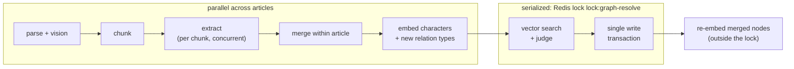

# Robustness & advanced design

This page is for readers who want to know what happens under concurrency and failure. It complements the [README](../README.md), which covers the [architecture](../README.md#architecture), the [graph schema](../README.md#graph-schema) and the [AI pipeline](../README.md#ai-pipeline).

- [Serialized resolve under a self-extending lock](#serialized-resolve-under-a-self-extending-lock)
- [NOT_SAME verdicts](#not_same-verdicts)
- [Reconciliation (opt-in)](#reconciliation-opt-in)
- [Stuck-article sweep](#stuck-article-sweep)
- [Retries on infrastructure errors](#retries-on-infrastructure-errors)
- [Streaming body limits](#streaming-body-limits)
- [Normalized content hash](#normalized-content-hash)
- [Never overwrite DONE](#never-overwrite-done)
- [PDF and vision details](#pdf-and-vision-details)
- [Limitations in detail](#limitations-in-detail)

## Serialized resolve under a self-extending lock

Dedup is only correct if the vector search sees every character committed so far. Resolve and persist therefore run under one Redis lock, `lock:graph-resolve` ([`app/pipeline/lock.py`](../app/pipeline/lock.py)). The README's [Processing phases](../README.md#processing-phases) explain why; the phases look like this:

- **Little work inside the lock.** Parsing, vision, extraction and embedding all happen *before* the lock is taken. Inside it remain the vector queries, the judge calls (capped per article) and one write transaction.
- **Timeout and extension.** The lock has a TTL of `RESOLVE_LOCK_TIMEOUT_SECONDS` (900 s), so a crashed worker cannot hold it forever. While it is held, a background task extends the TTL every third of the timeout. `Settings` refuses to start unless the TTL exceeds the worst-case judge time of one article: `DEDUP_MAX_JUDGE_CALLS_PER_ARTICLE × JUDGE_TIMEOUT_SECONDS × (JUDGE_MAX_RETRIES + 1) × 2`. The last factor is the two structured-output attempts, since an invalid output is asked for again. With the defaults that is 10 × 20 × 2 × 2 = 800 s, under the 900 s TTL. The judge has its own timeout and SDK retry budget for this reason: under the extraction settings of the Gemini profile (`LLM_MAX_RETRIES=6`, 60 s timeout), one judge call alone could take 7 × 60 × 2 = 840 s. Extraction, vision and embeddings keep `LLM_TIMEOUT_SECONDS` and `LLM_MAX_RETRIES`. The TTL alone therefore covers a full judge budget, even if every extension fails. Two waits are not counted in the bound: the SDK's backoff sleeps between retries, and the time a judge call inside the lock waits for the per-process `LLM_MAX_CONCURRENCY` semaphore, which it shares with the extraction, vision and embedding calls of other articles in the same worker. The lock extension covers both, because the lock stays alive as long as its holder is.
- **Ownership check.** Just before the write transaction, `ensure_owned()` checks that the key still holds this worker's token. If the lock was lost, for example to a Redis failover or an expiry, the article fails with `ResolveLockLostError` instead of writing on top of someone else's resolve. The same happens when an extension finds the lock gone.
- **Release failures.** A failure to release the lock is logged, and it never fails an article that was already persisted. The TTL cleans up.
- **Waiting for the lock.** Article jobs wait up to `RESOLVE_LOCK_ACQUIRE_TIMEOUT_SECONDS` (600 s). The HTTP merge waits only `MERGE_LOCK_ACQUIRE_TIMEOUT_SECONDS` (10 s) and then answers `409 resource_busy`, because an HTTP caller must not hang for minutes.
- **Re-embedding.** Nodes that absorbed a new mention get their new embedding *after* the transaction, outside the lock. The write is a compare-and-set on name, aliases and description, so it never overwrites a newer profile. If the re-embedding fails, the node keeps `embedding_stale = true`, and reconciliation repairs it.
- **Test coverage.** `test_concurrent_articles_do_not_duplicate_new_character` in [`tests/integration/test_pipeline.py`](../tests/integration/test_pipeline.py) processes two articles that share a new character concurrently and checks that they produce exactly one `Character` node.

## NOT_SAME verdicts

When the judge decides that two profiles are different people, that verdict is stored as `(:Character)-[:NOT_SAME {reason, judged_at, hash_low, hash_high}]->(:Character)`. There is one edge per pair, directed from the lower id to the higher id.

- **Profile hashes.** The edge records a hash of each side's profile: SHA-256 over the normalized name, the sorted normalized aliases and the description ([`app/domain/profiles.py`](../app/domain/profiles.py)).
- **Freshness.** A verdict counts only while both hashes still match the current profiles. Once a node learns a new alias or a better description, the old "no" is stale and the pair may be judged again. Without the hashes, either a stale "no" would block a merge forever, or the judge would be asked the same question on every upload.
- **Who uses it.** Ingestion skips the judge for candidates with a fresh `NOT_SAME`; its auto-merge band does not consult verdicts. Reconciliation skips such pairs in both bands.
- **Manual merge overrides it.** The merged-away nodes are deleted together with their `NOT_SAME` edges.

## Reconciliation (opt-in)

Ingestion-time dedup misses some duplicates. Three causes are inherent: the judge budget runs out, the judge is unavailable (for example rate-limited), or a similarity lands just below the band before a later article adds the context that would have matched. Reconciliation ([`app/pipeline/reconcile.py`](../app/pipeline/reconcile.py)) is the background safety net:

1. It first repairs `embedding_stale` nodes, with one embedding call per batch.
2. It checks the `needs_reconcile` nodes first, so they get the judge budget before anything else. Then it walks all other characters oldest first in keyset-paged batches (`RECONCILE_BATCH_SIZE`). Each one is matched against its nearest neighbours with the same thresholds and judge as ingestion, with graph context. The run has its own judge budget (`RECONCILE_MAX_JUDGE_CALLS`, 40). Each judge call costs the same as at ingestion, up to `JUDGE_TIMEOUT_SECONDS × (JUDGE_MAX_RETRIES + 1) × 2` (80 s with the defaults). `Settings` refuses to start unless the whole run budget at that worst case stays below `JOB_TIMEOUT_SECONDS` (40 × 80 s = 3200 s < 3600 s), so spending the full judge budget alone cannot make the job timeout cancel a run. The bound counts judge time only. Embedding repair and re-embedding calls, merge lock waits, Neo4j queries, waits for the `LLM_MAX_CONCURRENCY` semaphore and the SDK's backoff sleeps are not counted; the remaining headroom of about 400 s absorbs them in practice. No resolve-lock bound applies, because the run judges without the resolve lock and each merge takes the lock separately.
   - A flag is cleared once its node has been checked with a working judge: it was merged, judged different, or has no candidates left in the band. A node keeps its flag when the run could not judge its candidates (spent budget, judge failure), when its merge was skipped because the lock was busy, or when a fresh `NOT_SAME` blocked an auto-merge, because then the band was never evaluated.
   - If the judge fails during a run, the run stops judging, as with a spent budget, but it keeps auto-merging and completes. One `judge_unavailable` warning logs the error type, the truncated error message and the number of characters left unjudged.
3. It merges the newer node into the older one, through the same code path as the manual merge, which takes the resolve lock with the short wait. If ingestion holds the lock, the pair is skipped and logged rather than blocking ingestion. Negative verdicts are recorded as `NOT_SAME`.
4. A clean graph costs no LLM calls, because stored vectors are reused.

**Who enables it.** An operator, by setting `RECONCILE_ENABLED=true`. The worker then runs it as an ARQ cron every `RECONCILE_INTERVAL_MINUTES` (default 60). The interval must divide 60, or be a whole number of hours that divides 24. Independently of that setting, anyone with an access token can trigger a run on demand with `POST /characters/reconcile`, which returns `202`. The scheduled and the manual run share the ARQ job id `reconcile`, so they can never overlap. A trigger while a run is queued or running is a no-op, and the response says so: `{"status": "already_queued"}` instead of `{"status": "queued"}`.

**Why it's off by default.** Every run can spend up to `RECONCILE_MAX_JUDGE_CALLS` paid judge calls, plus embeddings, on a timer, whether or not anything was uploaded. A demo stack should not spend money silently in the background. Ingestion-time dedup handles the common case, and the manual trigger covers the rest until an operator decides the cost is worth a schedule.

## Stuck-article sweep

A worker killed mid-job (OOM, `kill -9`, host reboot) could leave its article in `processing` forever. ARQ runs each job at most `JOB_MAX_TRIES` (3) times, with a job timeout of `JOB_TIMEOUT_SECONDS` (3600 s), and a job that keeps failing must still end somewhere. The sweep ([`app/pipeline/sweep.py`](../app/pipeline/sweep.py)) is a separate cron, **enabled by default** (`STUCK_SWEEP_ENABLED`, every `STUCK_SWEEP_INTERVAL_MINUTES` = 10 min).

- **What it does.** One pass with no LLM calls. It lists the articles still `pending` or `processing` whose `updated_at` is older than `STUCK_ARTICLE_AFTER_SECONDS` (4200 s). It drops those whose ARQ job still exists, checked as the job key or in-progress key of `article:<id>` with one pipelined `EXISTS` batch per page of 500. A job that is queued, deferred for a retry or running is therefore never swept. The rest become `failed` with the error `Stuck: no progress within job timeout`, through a conditional update that re-checks status and age. Uploading the same content again re-queues them.
- **Cancellation.** A cancelled job, on timeout or graceful shutdown, marks its article failed immediately (`Cancelled: job timeout or worker shutdown`). Before the last try it keeps the blob: ARQ runs a job cancelled by a shutdown again, and that run re-claims the `failed` article (the claim only skips `done`) and processes it from the kept blob. On the last try (`JOB_MAX_TRIES`) ARQ will not run the job again, so the blob is deleted. After a timeout on an earlier try ARQ does not run the job again either; the blob then stays until a re-upload re-queues the article and overwrites it.
- **Timeouts are ordered at startup.** `Settings` refuses to start unless:
  - `JOB_TIMEOUT_SECONDS` exceeds `RESOLVE_LOCK_ACQUIRE_TIMEOUT_SECONDS + RESOLVE_LOCK_TIMEOUT_SECONDS`, because a job may wait for the lock and then hold it;
  - `STUCK_ARTICLE_AFTER_SECONDS` exceeds `JOB_TIMEOUT_SECONDS`;
  - `JOB_RETRY_DELAY_SECONDS` is less than `STUCK_ARTICLE_AFTER_SECONDS - JOB_TIMEOUT_SECONDS`.

  The age threshold therefore gives a running job time to finish and a retry delay time to pass. The job-key check covers what age cannot, such as a long wait in the queue.
- **Backlog.** A `pending` article whose job is still waiting in the queue has a live job key, so the sweep leaves it alone, however long the backlog. The sweep never deletes blobs, so an article failed by mistake can still be finished by a late job or re-queued by a re-upload.

## Retries on infrastructure errors

The raw upload is the only copy of the input, so the worker deletes it only once the article has reached a final state: `done` persisted, `failed` persisted, already `done`, or not found ([`app/pipeline/process.py`](../app/pipeline/process.py)).

- **What is retried.** Outages of the stores: Neo4j `ServiceUnavailable`, `SessionExpired`, `TransientError` and `ConnectionAcquisitionTimeoutError`, Redis `ConnectionError` and `TimeoutError`, and a lost resolve lock whose extension failed on a Redis error ([`app/pipeline/infrastructure.py`](../app/pipeline/infrastructure.py)). Wherever such an error hits, whether reading the article, in the middle of the pipeline (lock, vector search, persist) or while storing a final status, a job before its last try writes no `failed`, keeps the blob and raises `arq.Retry`. ARQ runs it again after `JOB_RETRY_DELAY_SECONDS` (30 s), up to `JOB_MAX_TRIES` (3) attempts in total ([`app/worker.py`](../app/worker.py)). The article stays `processing` in between, and the retry re-claims it.
- **What is final.** Every other error marks the article `failed` at once, and the blob is deleted; uploading the same content again re-queues it. Redis `AuthenticationError` and `AuthorizationError` subclass `ConnectionError` but are configuration errors that a retry cannot fix, so they are checked first and are final.
- **Retries are safe.** A job skips `done` articles, and its claim of an article (`processing`) only skips `done`. A retry therefore picks up an article left in `processing` (claimed, then Neo4j went away before `failed` was written) or `failed` by a cancellation, and the write transaction makes a repeated run idempotent.
- **Exhausted retries.** On the last try an infrastructure error in the pipeline marks the article `failed` with that error, deletes the blob and logs `article_retry_exhausted`. If even that write fails, because the store is still down, the job logs `article_retry_exhausted` and fails with the blob kept. The [stuck-article sweep](#stuck-article-sweep) later marks the article `failed`, and a re-upload re-queues it.
- **One job per article.** Article jobs are enqueued with the ARQ job id `article:<id>` and keep no result. While a job for an article is queued, deferred for a retry or running, enqueueing it again adds nothing, so a re-upload cannot start a second, concurrent run. Once the job has finished, the id is free again, and the re-upload of a `failed` article queues a new job.

### Residual windows

The retry budget is short, and two narrow windows are left to the sweep. Each window ends with the article `pending` or `failed`, and a later re-upload recovers it:

- **Retry budget.** It covers short outages: 3 tries with 30 s between them, about a minute. If Neo4j or Redis is down for longer, the last try marks the article `failed` (or, if even that write fails, the [stuck-article sweep](#stuck-article-sweep) does later), and a re-upload re-queues it.
- **Re-upload right after a failure.** Between a job writing `failed` and ARQ releasing the job id `article:<id>` there are a few milliseconds. A re-upload in that window resets the article to `pending`, but its enqueue is a no-op, and the finishing job deletes the blob it just saved. The article waits for the sweep, and a re-upload after that re-queues it.
- **Shutdown on the last try.** A job cancelled by a shutdown on its last try marks the article `failed` and deletes the blob, but ARQ keeps the job id until a worker restarts and rejects the job as out of tries. A re-upload during that downtime resets the article to `pending`, but the enqueue is a no-op, and the restarted worker drops the old job without running it. The sweep later marks the article `failed`, and a re-upload re-queues it.

## Streaming body limits

`MAX_UPLOAD_BYTES` (20 MiB) limits the article content, meaning the text bytes or the file bytes ([`app/api/uploads.py`](../app/api/uploads.py)). The HTTP body is limited before it is parsed:

- **Per-format allowance.** The request body may be at most `MAX_UPLOAD_BYTES × expansion + 64 KiB`. The expansion factor depends on the encoding overhead of the media type: 6× for JSON (a `\uXXXX` escape is 6 bytes per character), 3× for urlencoded (`%XX`), 1× for multipart and for a raw `text/markdown` or `text/plain` body. A legitimate 20 MiB article therefore always fits, and a hostile body cannot.
- **Content-Length.** A declared `Content-Length` over the limit is rejected with `413` before a single byte is read.
- **Streaming check.** The ASGI `receive` channel is wrapped, so the bytes are counted while they stream in. Chunked bodies without a `Content-Length` are cut off as soon as they cross the limit, instead of being buffered into memory or a temp file.
- **Final check.** Multipart parts are capped as well, and the decoded content is checked against `MAX_UPLOAD_BYTES` exactly.
- **Every other endpoint.** Bodies of all other requests (`/auth/token`, `/auth/refresh`, `/characters/merge`, …) are capped at 64 KiB by a middleware ([`app/api/middleware.py`](../app/api/middleware.py)), by `Content-Length` and while streaming, with `413`. Their fields are capped too: `app_token` and `refresh_token` at 4096 characters, `source_ids` at 50 ids, and an upload `title` at 300 characters (`422`).
- **Huge texts.** An article that splits into more than `MAX_CHUNKS_PER_ARTICLE` (200) chunks fails with a clear error before any extraction call, so one enormous text cannot run up hundreds of paid LLM calls.

## Normalized content hash

- **Text uploads.** The service hashes a **normalized** form of the text ([`app/ingestion/fingerprint.py`](../app/ingestion/fingerprint.py)): BOM stripped, NFKC, CRLF/CR turned into LF, trailing whitespace trimmed, runs of spaces and tabs collapsed, three or more newlines reduced to a blank line, and the whole text trimmed. The same story pasted as JSON, typed with Windows line endings, sent as a raw `text/markdown` body, or uploaded as an `.md` file is therefore recognised as one article. Any real change in wording is a new article.
- **PDFs.** These are hashed byte for byte.
- **Concurrent identical uploads.** The unique constraint on `content_hash` makes two such uploads resolve to one article. The loser deletes its blob and returns the winner.

## Never overwrite DONE

A finished article is final. Every failure path goes through a conditional `SET … WHERE status <> 'done'`: an exception in the pipeline, a cancellation, a dispatch failure after enqueue, or the sweep (which matches only `pending`/`processing`). So does the worker's claim of an article (`processing`): if a duplicate job finished the article between the status read and the claim, the claim matches nothing and the job skips the article. The worker skips articles that are already `done`, and re-uploading a `done` article returns it with `200` instead of reprocessing. A late or duplicate failure signal therefore cannot flip a persisted article to `failed` and invite a second, duplicating run.

## PDF and vision details

([`app/ingestion/pdf.py`](../app/ingestion/pdf.py))

- **Embedded images.** An embedded image is described if its shorter side is at least `PDF_MIN_IMAGE_SIDE` (100 px), which skips icons and decorations. Each image is described once per document, even if it repeats on several pages.
- **Rendering whole pages.** A page is rendered as a whole, at `PDF_RENDER_DPI` (150), in two cases:
  - it has less than `PDF_SCANNED_PAGE_MIN_CHARS` (50) of text but has images or drawings, as a scan does;
  - it has at least `PDF_DRAWINGS_MIN_COUNT` (20) significant vector drawings covering at least `PDF_DRAWINGS_MIN_AREA_RATIO` (12%) of the page, as charts and diagrams drawn as vectors do.
- **Significant drawings.** Unfilled paths made only of axis-aligned lines and rectangles, such as table borders and frames, count as decorative. `VISION_MODE=all_pages` renders every non-blank page instead.
- **Unfilled org charts are not rendered.** The same rule makes an org chart drawn with unfilled rectangles and straight connectors decorative, so on a page with at least `PDF_SCANNED_PAGE_MIN_CHARS` of text it is not rendered. Only its text layer, the names and edge labels, reaches extraction, under no marker. The bare-labels rule of the extraction prompt keeps the model from pairing those names. Workaround: `VISION_MODE=all_pages`, with `PDF_MAX_IMAGES` raised to the page count.
- **Vision cap.** `PDF_MAX_IMAGES` (20) caps the vision calls per document, not the images. A page rendered whole is one call however many images it embeds: a low-text page with six photos is rendered as one frame. Each standalone embedded image on a text page is one call. When the budget is short, page renders go first, in page order, then standalone images, in page order, because a render covers the page's images and drawings at once. The calls over the cap are counted in `stats.images_skipped` and logged once as `pdf_image_cap_reached` with the dropped count.
- **Undescribed figures are marked.** If a page that qualifies for a whole-page render in `auto` mode (a scan, a low-text page with visuals, or a graphical page) gets no description, because of the vision cap, the pixel cap or a failed vision call, its text is prefixed with `[Figure on page N not described: the text below includes its labels, which state no relationships]`. The extraction prompt forbids building relationships from such labels, as from any bare list, caption or table cell. Pages rendered only because of `VISION_MODE=all_pages` are prose and get no marker.
- **Pixel cap.** `PDF_MAX_RENDER_PIXELS` (25,000,000 pixels) bounds the size of every image sent to the vision model, and of every embedded image the service decodes itself. An embedded image is checked by its declared width × height *before* it is decoded, and skipped if it is over the cap. A page rendered whole is rendered at the highest DPI up to `PDF_RENDER_DPI` whose output fits the cap. If that would need less than 36 DPI, the page is skipped and gets no vision call, because the text would be unreadable. The cap applies to the rendered output: images embedded in a page rendered whole are not checked separately, and MuPDF subsamples them while rendering. Rendering a page that embeds a 16000 × 16000 image measured about 94 MB peak RSS. Skipped pages and images, and images that fail to decode, are counted in `stats.images_skipped`, and vision calls that fail in `stats.images_failed`.
- **Thread safety.** PyMuPDF is not thread-safe, so a module-level lock serializes document access within a process. The vision calls run concurrently outside the lock.

## Limitations in detail

The README lists these in [Limitations & next steps](../README.md#limitations--next-steps); here is the full reasoning.

- **Dedup is probabilistic.** It is deliberately biased towards *not* merging, and the judge sees graph context. Two articles about different people with the same name stay apart, but a true duplicate described too differently can stay apart as well. The mitigations are already built: the [reconciliation job](#reconciliation-opt-in) and the manual merge endpoint.
- **Profile embeddings mix the name with the story context.** People from the same story have similar profiles, so the cosine barely separates a different person in the same story from the same person under a name in another language ([measured](llm-providers.md#measured-on-real-embeddings): 0.801 for the same person, 0.772 for different people); the judge has to decide. Next step: embed the name separately from the description, or weight the name, to improve the separation.
- **No split endpoint yet.** Splitting a wrong merge would be `POST /characters/{id}/split` with a list of article ids:
  1. Create a new node from the `APPEARS_IN.mentions_json` provenance of those articles (surface names and per-article descriptions).
  2. Move those `APPEARS_IN` edges and every `RELATED_TO` edge whose `article_id` is in the list.
  3. Recompute the aliases, description and embedding of both nodes from their remaining mentions.
  4. Record a `NOT_SAME` between them, so that reconciliation does not merge them again.

  The provenance on `APPEARS_IN` and the `article_id` on every `RELATED_TO` edge exist for this.
- **Generic role words can become aliases.** The extraction prompt excludes generic descriptions, but a cheaper extraction model can still list an unnamed «подруга» ("her friend") as a character. If the judge then merges it into the right person, the generic word becomes that person's alias; this happened in the [live run](llm-providers.md#measured-on-real-embeddings). Next step: filter generic nouns and pronoun-like aliases before they are stored.
- **Evidence is not verified.** The model is asked for a verbatim quote, but nothing checks it. Next step: an `evidence_verified` flag on `RELATED_TO`, set by a fuzzy match of the quote against the chunk. Unverified relations would be flagged and never dropped, because paraphrased evidence is still often right.
- **Provenance stops at article level.** Edges record the article, not the chunk or page.
- **One global resolve lock.** It is simple and correct, but it serializes resolve+persist across all articles. Sharding the lock (for example by a normalized-name key) would raise throughput.
- **A small window remains after the ownership check.** Between the last `ensure_owned()` and the commit there is a window of milliseconds in which the lock could expire. A fencing token checked inside the transaction would close it.
- **Embeddings lag merges briefly.** Between persist and re-embedding, a merged node is still found by its pre-merge vector. A failed re-embedding leaves `embedding_stale = true`, which only reconciliation repairs, and reconciliation is opt-in or manual.
- **Revocation of a single family does not reach access tokens.** Revoking a refresh family (reuse detection, family lifetime) does not invalidate access tokens that were already issued, because they are verified statelessly. They stay valid for up to 900 s. A `jti` denylist, or a shorter TTL, would close the gap. Removing an app from `APP_TOKENS` does reach them, because every access token is checked against the configured apps.
- **Changing `EMBEDDING_DIM` needs a fresh database.** `CREATE VECTOR INDEX … IF NOT EXISTS` never alters an existing index, and stored vectors keep the old size. Startup detects the mismatch and stops. A dimension change therefore needs a fresh database (`docker-compose down -v`).
- **PyMuPDF is not thread-safe.** Parsing is serialized per process by a lock, while the vision calls still run in parallel. To scale, add worker processes (`docker-compose up -d --scale worker=N`) or move parsing of huge PDFs to a `ProcessPoolExecutor`. `pymupdf` is pinned `<2`, because 2.x pulls `onnxruntime`, which has no macOS x86_64 wheel.
- **Org charts of unfilled boxes are not rendered.** Table borders and an org chart drawn with unfilled rectangles and straight connectors are the same kind of path, and the decorative rule cannot tell them apart, so such a chart on a text page reaches extraction only as its labels ([details](#pdf-and-vision-details)). `VISION_MODE=all_pages` is the workaround. Next step: a heuristic that tells org charts, separate boxes joined by connectors, from tables, whose cells share edges.
- **Some tables are rendered unnecessarily.** Thin *filled* rules, such as LaTeX booktabs tables, count as significant drawings, so a table-heavy text page may be rendered and sent to the vision model. This costs money but does not affect correctness.
- **Articles are deduplicated by exact match only.** The normalized hash catches identical content. Near-duplicates (an edited copy) are new articles. MinHash/SimHash would catch them.
- **Some LLM failures are retried uselessly.** The OpenAI SDK retries `429 insufficient_quota` like a transient error.
- **Short retry budget, and two narrow windows left to the sweep.** See [Residual windows](#residual-windows).
